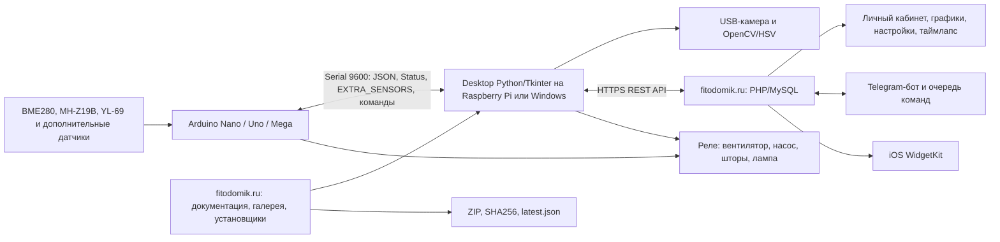
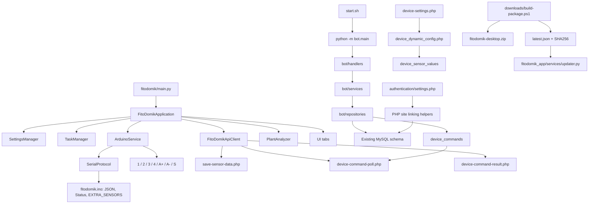

# ФитоДомик

Актуальные изменения 1.0.1, порядок миграций и ограничения проверки: [заметки к выпуску 1.0.1](#обновление-101). Исходник desktop — `fitodomik/`; дистрибутив формируется скриптом сборки.

**Комплексная система управления микроклиматом, выращивания растений и удалённого контроля**

ФитоДомик объединяет аппаратную автоматику на Arduino, Raspberry Pi, desktop-приложение на Python/Tkinter, личный кабинет и REST API на PHP/MySQL, Telegram-бота, публичный сайт проекта, установщики, iOS-приложение и виджет, а также готовые Android APK.

| Роль            | Участник                                |
| --------------- | --------------------------------------- |
| Автор проекта   | Домнин Вячеслав Иоревич, ученик 11 «А»  |
| Соавтор проекта | Изразцов Илья Дмитриевич, ученик 11 «А» |

## Быстрый старт

### Linux и Raspberry Pi

```bash
curl -sSL https://fitodomik.ru/install | bash
```

### Windows PowerShell

```powershell
powershell -NoProfile -ExecutionPolicy Bypass -Command "irm https://fitodomik.ru/install/windows | iex"
```

> Установщик загружается с сайта и выполняется локально.
> Перед использованием в чувствительной среде скачайте скрипт, изучите его содержимое и проверьте контрольную сумму пакета.

### Запуск из исходников

Замените `<URL-репозитория>` на адрес репозитория, из которого получены исходники:

```bash
git clone <URL-репозитория>
cd fitodomik_oop/fitodomik
python3 -m venv --system-site-packages .venv
source .venv/bin/activate
python3 -m pip install -r requirements.txt
python3 main.py
```

### Запуск на Raspberry Pi OS

```bash
~/fitodomik/launch_on_raspberry.sh
```

## Актуальные адреса

- Сайт: [https://fitodomik.ru/](https://fitodomik.ru/)
- Личный кабинет: [https://fitodomik.ru/farm.php](https://fitodomik.ru/farm.php)
- API: [https://fitodomik.ru/api/](https://fitodomik.ru/api/)
- Вход: [https://fitodomik.ru/authentication/login.php](https://fitodomik.ru/authentication/login.php)
- Регистрация: [https://fitodomik.ru/authentication/register.php](https://fitodomik.ru/authentication/register.php)

## Статус

ФитоДомик является работающим инженерно-программным комплексом и одновременно учебно-исследовательским проектом. В репозитории присутствуют компоненты, близкие к промышленной эксплуатации, экспериментальные функции, установочные пакеты и исторический код.


| Область                   | Текущий статус                                                                                                                             |
| ------------------------- | ------------------------------------------------------------------------------------------------------------------------------------------ |
| Desktop на Python/Tkinter | Реализован, модульная структура `fitodomik_app`, запуск через `python main.py`                                                             |
| Arduino                   | Реализованы базовая прошивка, генерация дополнительной конфигурации, компиляция и загрузка через `arduino-cli`                             |
| Личный кабинет и API      | Реализованы на PHP/MySQL; API охватывает данные, устройства, конфигурации, сценарии и команды                                               |
| Multi-device              | Реализованы `device_id`, `device_token`, выбор активного устройства и фильтрация данных                                                    |
| Telegram                  | Реализовано постоянное Python-приложение на aiogram 3: привязка, команды, уведомления, очередь команд и скрипт восстановления через cron   |
| Публичный сайт            | Реализованы документация, галерея, админка, загрузки и веб-установщики                                                                     |
| iOS                       | Исходники SwiftUI-приложения и WidgetKit-виджета присутствуют; серверный endpoint виджета нужно сверить перед публикацией                  |
| Android                   | В корне есть готовые APK                                                                                                                   |
| Компьютерное зрение       | Реализован эвристический OpenCV/HSV-анализ; YOLO еще нет из-за слабого железа                                                              |

## Оглавление

<details>
<summary>Показать разделы README</summary>

- [Быстрый старт](#быстрый-старт)
- [Актуальные адреса](#актуальные-адреса)
- [Статус](#статус)
- [О проекте](#о-проекте)
- [Теоретическая основа](#теоретическая-основа)
- [Общая архитектура](#общая-архитектура)
- [Ключевые инженерные решения](#ключевые-инженерные-решения)
- [Ход выполнения работы](#ход-выполнения-работы)
- [Аппаратная часть](#аппаратная-часть)
- [Desktop-приложение](#desktop-приложение)
- [Arduino и Serial-протокол](#arduino-и-serial-протокол)
- [Дополнительные датчики и динамическая конфигурация](#дополнительные-датчики-и-динамическая-конфигурация)
- [Личный кабинет fitodomik.ru](#личный-кабинет-fitodomikru)
- [Telegram-бот](#telegram-бот)
- [Ключевые фрагменты реализации](#ключевые-фрагменты-реализации)
- [Как связаны основные файлы](#как-связаны-основные-файлы)
- [Мини-сценарии использования](#мини-сценарии-использования)
- [Публичный сайт fitodomik.ru](#публичный-сайт-fitodomikru)
- [Установщики и обновления](#установщики-и-обновления)
- [Настройка после установки](#настройка-после-установки)
- [Эксплуатация и обслуживание](#эксплуатация-и-обслуживание)
- [iOS-приложение и виджет](#ios-приложение-и-виджет)
- [Android-приложение и виджет](#android-приложение-и-виджет)
- [Безопасность](#безопасность)
- [Частые проблемы](#частые-проблемы)
- [Экономическая эффективность](#экономическая-эффективность)
- [Экспериментальные результаты проектной работы](#экспериментальные-результаты-проектной-работы)
- [Заключение](#заключение)
- [Список литературы](#список-литературы)

</details>

## О проекте

### Название

**«ФИТОДОМИК — умная система управления микроклиматом для растений»**

### Исходная идея

Создать доступную автоматизированную среду выращивания растений, которая:

- контролирует температуру, влажность, давление, концентрацию CO₂ и влажность почвы;
- управляет освещением, поливом, вентиляцией и шторами;
- показывает данные локально и удалённо;
- сохраняет историю показаний;
- помогает анализировать состояние растения по изображению;
- остаётся ремонтопригодной и понятной для учебного использования.

### Формат проекта

Проект сочетает:

- физику и биологию микроклимата;
- электронику и микроконтроллеры;
- программирование на C++, Python, PHP, JavaScript и Swift;
- базы данных и REST API;
- компьютерное зрение;
- web-разработку;
- информационную безопасность;
- экспериментальную проверку и экономическое сравнение.

### Актуальность

В проектной работе актуальность ФитоДомика рассматривается через несколько групп факторов.

**Глобальные вызовы**

- рост населения и потребности в продуктах питания;
- изменение климата и нестабильность условий выращивания;
- урбанизация и сокращение доступной площади для традиционного земледелия;
- необходимость экономить воду и энергию.

**Технологические тенденции**

- развитие интернета вещей;
- распространение домашнего растениеводства и малых гидропонных систем;
- доступность микроконтроллеров и одноплатных компьютеров;
- автоматизация повторяющихся операций;
- применение компьютерного зрения для наблюдения за растениями.

**Образовательная ценность**

- практическое изучение программирования, электроники и физики;
- развитие инженерного мышления;
- работа с измерениями, гипотезами и экспериментами;
- объединение нескольких школьных дисциплин в одном работающем прототипе.

**Социально-экономические факторы**

- интерес к качеству и происхождению продуктов;
- возможность выращивания растений в городской среде;
- доступность ремонта и замены отдельных модулей;
- снижение зависимости от закрытых коммерческих систем.

### Цель

Разработать комплексную доступную систему автоматизации выращивания растений, включающую:

1. микроконтроллерную часть;
2. desktop-приложение;
3. удалённый личный кабинет и REST API;
4. публичный информационный сайт;
5. средства уведомления и управления;
6. документацию и установочные инструменты.

### Задачи

**Исследовательские**

- определить параметры, влияющие на микроклимат;
- изучить способы измерения температуры, влажности, CO₂, давления и влажности почвы;
- сравнить существующие автоматизированные решения;
- оценить стоимость и ремонтопригодность.

**Аппаратные**

- подобрать микроконтроллер, датчики, реле и исполнительные устройства;
- собрать электрическую схему;
- обеспечить безопасное питание;
- проверить работу насоса, лампы, вентилятора и штор.

**Программные**

- разработать прошивку Arduino;
- создать графический интерфейс для Raspberry Pi и Windows;
- реализовать хранение, визуализацию и передачу данных;
- создать web-кабинет, API и Telegram-интеграцию;
- организовать обновление и диагностику.

**Экспериментальные**

- проверить точность показаний;
- оценить надёжность длительной работы;
- сравнить автоматический и ручной уход;
- проанализировать потребление воды и времени;
- проверить алгоритм анализа изображений.

### Гипотеза

В школьной работе была выдвинута гипотеза, что на базе доступных компонентов можно создать систему автоматизации растениеводства, сопоставимую по основным возможностям с коммерческими решениями, но более доступную, открытую и ремонтопригодную.

Текущий workspace подтверждает реализуемость многокомпонентной архитектуры. Количественные выводы о превосходстве над коммерческими системами требуют повторного испытания на одинаковых условиях и актуальных ценах.

### Ожидаемые результаты

- измерение не менее пяти параметров среды;
- управление несколькими исполнительными устройствами;
- локальный интерфейс;
- удалённое наблюдение и управление;
- история и графики;
- модульное расширение датчиков;
- документация и воспроизводимая установка;
- возможность использования проекта как учебного стенда.

### Практическая значимость

- учебный лабораторный стенд;
- домашняя автоматизированная мини-теплица;
- основа для курсов по IoT, Python, Arduino и web-разработке;
- прототип для дальнейших агротехнических исследований;
- пример полного жизненного цикла: от схемы и прошивки до API, безопасности и установщика.

### Инновационность

Инновационность проекта заключается не в одном датчике или алгоритме, а в объединении аппаратной автоматики, локального GUI, удалённого кабинета, Telegram, динамических профилей датчиков и инструментов доставки в одну открытую систему.

## Теоретическая основа

### Проблема автоматизации растениеводства

Растению требуется устойчивый диапазон температуры, влажности воздуха, освещения, влажности субстрата и газового состава. Ручной контроль зависит от присутствия человека, плохо масштабируется и часто реагирует на проблему уже после появления внешних признаков.

Автоматизированная система решает четыре задачи:

1. **наблюдение** — регулярно получает показания;
2. **сравнение** — сопоставляет значения с порогами и расписанием;
3. **воздействие** — включает исполнительное устройство;
4. **обратная связь** — проверяет новое состояние и сохраняет историю.

### Эффективность ресурсов

Автоматизация позволяет подавать воду и свет по условию или расписанию, а не постоянно. Практический эффект зависит от:

- калибровки датчика почвы;
- расположения датчиков;
- производительности насоса;
- герметичности и теплообмена корпуса;
- мощности освещения;
- алгоритмов задержки и гистерезиса;
- корректности расписания.

### Анализ аналогов в проектной работе

В школьной работе приводилось ориентировочное сравнение:

| Аналог                         | Указанная стоимость |
| ------------------------------ | ------------------- |
| Growbox                        | 18 321 ₽            |
| Grow cabinet TOWER STEALTH     | 96 797 ₽            |
| AtomPot Two                    | 73 000 ₽            |
| Историческая сборка ФитоДомика | 6 024 ₽             |


Цены относятся к периоду подготовки проектной работы. Комплектация, качество корпуса, гарантия и готовность аналогов могут различаться.

## Общая архитектура



### Потоки данных

1. Arduino опрашивает базовые и дополнительные датчики.
2. Показания передаются по Serial.
3. Desktop парсит сообщения, обновляет UI, сохраняет локальную историю и при необходимости отправляет данные на сервер.
4. `fitodomik.ru` связывает данные с проверенными `user_id` и `device_id`.
5. Пользователь работает с активным устройством через кабинет или Telegram.
6. Удалённые команды помещаются в очередь.
7. Raspberry Pi опрашивает очередь, выполняет разрешённую команду и отправляет результат.

### Границы ответственности

| Компонент              | Ответственность                                        |
| ---------------------- | ------------------------------------------------------ |
| Arduino                | Быстрый опрос датчиков и управление реле               |
| Raspberry Pi / desktop | UI, камера, история, сценарии, сеть, обновления        |
| Backend/API            | Аккаунты, устройства, API, графики, команды, Telegram  |
| Публичный сайт         | Публичная документация, загрузки, установщики, галерея |
| iOS-приложение и виджет | Компактное отображение состояния                      |

### Как работает один полный цикл

Ниже показан типичный путь одного измерения температуры от физического датчика до возможного автоматического действия:

1. BME280 измеряет температуру, влажность и давление.
2. Arduino формирует строку JSON и передаёт её по Serial 9600.
3. `SerialProtocol` в desktop-приложении проверяет формат и преобразует строку в `SensorSnapshot`.
4. Desktop применяет настроечные поправки калибровки и обновляет карточки мониторинга.
5. Снимок добавляется в локальную историю и очередь отправки; графики получают новые точки.
6. При наличии сети desktop отправляет POST-запрос с данными формы в `fitodomik.ru/api/save-sensor-data.php`.
7. Сервер проверяет учётные данные аккаунта и устройства, сам определяет владельца и сохраняет данные с проверенным `device_id`.
8. Личный кабинет строит графики и статус только для выбранного устройства.
9. Desktop проверяет локальные alert rules и сценарии; серверные Telegram-настройки и cron независимо проверяют включённые уведомления.
10. Если условие сценария выдержано заданное время, desktop может включить реле, выполнить импульс насоса, сделать фото, запустить анализ или записать уведомление.
11. Результат сценария или удалённой команды отправляется в журнал; при отсутствии сети он остаётся в локальной очереди до следующей синхронизации.

Автоматическое действие не является безусловным следствием любого превышения порога. Оно выполняется только при включённом и корректно настроенном правиле, наличии нужного реле и работающем desktop-процессе.

## Ключевые инженерные решения

Архитектура формировалась не как набор модных технологий, а как последовательный ответ на ограничения школьного стенда, Raspberry Pi, shared-хостинга и реального оборудования.

| Решение                                | Почему выбрано                                                                                                        | Практическая польза                                                                                                                            |
| -------------------------------------- | --------------------------------------------------------------------------------------------------------------------- | ---------------------------------------------------------------------------------------------------------------------------------------------- |
| Arduino + Raspberry Pi                 | Arduino предсказуемо опрашивает датчики и управляет реле, а Raspberry Pi удобен для GUI, сети, камеры и фоновых задач | Физический контур не зависит от скорости интерфейса или HTTP-запросов                                                                          |
| Tkinter/ttk                            | Входит в стандартную экосистему Python, легче тяжёлых GUI-фреймворков и подходит для Raspberry Pi                     | Меньше зависимостей, проще установка, переносимость между Linux и Windows                                                                      |
| Модульный пакет `fitodomik_app`        | Один большой Python-файл стало трудно тестировать и развивать                                                         | UI, настройки, Serial, API, анализ, обновления и очереди развиваются независимо                                                                |
| Lazy imports                           | OpenCV, NumPy, Matplotlib и некоторые вкладки заметно замедляют холодный запуск                                       | Тяжёлые модули загружаются только при открытии соответствующей функции                                                                         |
| OpenCV/HSV вместо нейросети            | Для локального анализа не требуются GPU, обучение и большая размеченная выборка                                       | Анализ работает автономно на доступном оборудовании, а ограничения метода остаются понятными                                                   |
| PHP/MySQL                              | Такой стек поддерживается shared-хостингом проекта и не требует постоянно работающего application server              | Личный кабинет, API и хранение доступны на недорогой инфраструктуре                                                                            |
| Python long polling + запуск через cron | Shared-хостинг не предоставляет отдельный process manager                                                            | `python -m bot.main` работает постоянно, файловый lock исключает дубликаты, а минутный запуск `start.sh` восстанавливает процесс после падения |
| `device_id` + `device_token`           | Одного account token недостаточно для безопасного разделения нескольких установок                                     | Данные, настройки, фото и команды получают явный device scope                                                                                  |
| QR без API-токена                      | Постоянный API-токен нельзя помещать в изображение, которое легко сфотографировать                                    | В QR используются временные данные привязки, а учётные данные выдаются только после подтверждения                                              |
| Очередь команд                         | Telegram и сайт не могут напрямую обращаться к Raspberry Pi за NAT или при временном отсутствии связи                | Устройство само забирает разрешённые команды и возвращает статус выполнения                                                                    |
| `GeneratedConfig.h` и `ExtraSensors.*` | Ручное переписывание базовой прошивки для каждого нового датчика слишком рискованно                                   | Дополнительные датчики подключаются через проверяемую сгенерированную конфигурацию с резервной базовой схемой                                  |
| Safe upload и safe delete              | Загружаемые имена, MIME и пути нельзя считать доверенными                                                             | Сервер создаёт имена, ограничивает типы файлов и удаляет только внутри разрешённого каталога                                                   |
| Установщик через `fitodomik.ru`        | Ручная сборка окружения на Raspberry Pi создаёт много различий между стендами                                         | Одна команда загружает проверяемый пакет, а `latest.json` и SHA256 поддерживают воспроизводимое обновление                                     |

## Ход выполнения работы

### Почему проект вырос

Первоначально ФитоДомик задумывался как автоматическая мини-теплица с Arduino, несколькими датчиками и четырьмя реле. Во время разработки стало понятно, что для реального использования недостаточно один раз считать показания и включить нагрузку. Потребовались история, графики, камера, удалённый доступ, уведомления, безопасная работа нескольких устройств, восстановление после отсутствия сети и воспроизводимая установка.

Поэтому проект постепенно разделился на уровни: Arduino отвечает за физический контур, Raspberry Pi и desktop — за локальную логику и интерфейс, `fitodomik.ru` — за аккаунты и удалённый доступ, Telegram — за быстрые команды, а `fitodomik.ru` — за документацию и доставку сборок.

### Этап 1. Постановка задачи

Сначала была сформулирована практическая цель: уменьшить объём ручного ухода за растением и одновременно собрать учебный стенд, на котором можно изучать датчики, микроконтроллеры, Python и web-разработку. Было решено не ограничиваться демонстрацией одного показания, а построить полный цикл «измерение — решение — действие — история — удалённый контроль».

### Этап 2. Подбор компонентов

Компоненты выбирались по доступности, наличию документации и совместимости с Arduino. BME280 объединил три климатических параметра в одном I²C-датчике, MH-Z19B дал отдельное NDIR-измерение CO₂, а YL-69/FC-28 позволил исследовать аналоговую калибровку почвы. Четырёхканальная релейная схема соответствовала четырём базовым исполнительным устройствам: вентилятору, насосу, шторам и лампе.

### Этап 3. Сборка аппаратной части

После проверки датчиков отдельно была собрана общая схема питания, Serial-связи и реле. Низковольтную управляющую часть отделили от силовой нагрузки, а active-low поведение релейного модуля зафиксировали в прошивке. В ранней версии применялся DS3231, но затем его исключили из актуальной целевой схемы: время может предоставлять Raspberry Pi и сервер.

### Этап 4. Arduino-прошивка

Первая прошивка должна была стабильно читать датчики, выдавать компактную строку и принимать простые команды даже при недоступном сайте. Поэтому базовый Serial-протокол сделан текстовым: JSON для показаний, `Status:` для реле и короткие команды `1`–`4`, `A+`, `A-`, `S`. Такой протокол легко проверить через Serial Monitor и сохранить совместимым при развитии desktop.

### Этап 5. Desktop-приложение

Ранняя desktop-реализация была ближе к монолитному Python-приложению. По мере добавления графиков, камеры, API, порогов и настроек один большой модуль стал мешать тестированию, поэтому код разделили на `core`, `services`, `ui` и отдельные вкладки. Tkinter/ttk сохранили ради лёгкой установки на Raspberry Pi, а тяжёлые зависимости начали загружаться лениво.

### Этап 6. Web-кабинет и API

Локального интерфейса оказалось недостаточно для наблюдения вне дома или школы. Появился `fitodomik.ru`: аккаунты, история показаний, графики, пороги, расписание, фотографии и REST API. PHP/MySQL выбраны из-за совместимости с имеющимся shared-хостингом и возможности разворачивать систему без отдельного application server.

### Этап 7. Telegram-бот

Для быстрых уведомлений и команд требовался интерфейс, который уже установлен у пользователя. Текущий бот работает как постоянное Python-приложение на aiogram 3 с long polling. Планировщик хостинга раз в минуту вызывает `start.sh`: launcher проверяет PID, а процесс дополнительно удерживает файловый lock, поэтому второй экземпляр не запускается. Бот не обращается к устройству напрямую: он помещает действие в общую очередь.

### Этап 8. Multi-device

Когда один аккаунт стал поддерживать несколько ФитоДомиков, простой `user_id` перестал однозначно определять источник данных. Были введены `device_id`, `device_token`, выбранное устройство и серверные проверки принадлежности. Это не только добавило переключение устройств, но и устранило риск смешивания показаний, фото, конфигураций и команд.

### Этап 9. Динамические датчики и сценарии

Фиксированный набор BME280, MH-Z19B и YL-69 ограничивал расширение стенда. Вместо постоянного ручного редактирования `fitodomik.ino` появились JSON-профили, проверка пинов, `GeneratedConfig.h`, `ExtraSensors.h/.cpp`, динамические значения и сценарии. Базовая прошивка при этом осталась резервным вариантом.

### Этап 10. Установщик и обновления

Ручное развёртывание Python, OpenCV, Arduino CLI и системных пакетов давало разные результаты на разных Raspberry Pi. Поэтому сборка была оформлена в ZIP, SHA256 и `latest.json`, а `fitodomik.ru` получил Linux и Windows bootstrap-установщики. Обновление desktop проверяет метаданные и не должно перезаписывать пользовательские runtime-данные.

### Этап 11. Безопасность и тестирование

После появления аккаунтов, uploads, Telegram и удалённых команд проект потребовал отдельного security-прохода. Были добавлены CSRF, CORS whitelist, device scope, prepared statements, безопасные upload/delete, нейтральные ошибки, защита секретов и статические анализаторы. Проверки разделили на безопасные программные тесты и аппаратные действия, которые запускаются только явно.

### Этап 12. Документация

Финальный этап объединил техническую документацию, школьную проектную работу, команды установки, эксплуатационный регламент и честные ограничения. Исторические результаты сохранены, но отделены от актуальных доказанных возможностей. Это позволяет использовать README и для защиты проекта, и как руководство разработчика/оператора.

## Аппаратная часть

### Вычислительные модули

| Компонент       | Назначение                                                                   |
| --------------- | ---------------------------------------------------------------------------- |
| Arduino Nano    | Основная плата ранней и базовой сборки                                       |
| Arduino Uno     | Поддерживаемый профиль `arduino:avr:uno`                                     |
| Arduino Mega    | Поддерживаемый профиль `arduino:avr:mega`, полезен при большом числе модулей |
| Raspberry Pi 3B | Запуск desktop-приложения, работа с камерой, API и локальным UI              |

Desktop также поддерживает Nano с обычным и старым загрузчиком и ручной FQBN.

### Базовые датчики

| Датчик        | Параметры                        | Интерфейс                |
| ------------- | -------------------------------- | ------------------------ |
| BME280        | температура, влажность, давление | I²C, обычно адрес `0x76` |
| MH-Z19B       | концентрация CO₂                 | UART, 9600 бод           |
| YL-69 / FC-28 | относительная влажность почвы    | аналоговый вход          |
| USB-камера    | фото, таймлапс, анализ растения  | USB/UVC                  |

### Ключевые характеристики базовых компонентов

| Компонент       | Характеристики из проектной сборки                                                             |
| --------------- | ---------------------------------------------------------------------------------------------- |
| Arduino Nano    | ATmega328P, 16 МГц, 32 КБ Flash, 2 КБ SRAM, 1 КБ EEPROM, 14 цифровых и 8 аналоговых входов     |
| BME280          | I²C `0x76`; −40…+85 °C; 0–100% RH; 300–1100 hPa; паспортные ориентиры ±0,5 °C, ±3% RH и ±1 hPa |
| MH-Z19B         | NDIR-метод; 400–5000 ppm; паспортный ориентир ±50 ppm; UART 9600 бод                           |
| YL-69 / FC-28   | резистивный аналоговый датчик; значение требует калибровки под конкретный субстрат             |
| Релейный модуль | 4 канала, управление 5 В, в проектной работе указаны оптопары PC817                            |
| USB-камера      | USB 2.0/UVC; в проектной сборке использовались режимы 1280×720 и 640×480                       |

### Примечание по методам измерения

- `MH-Z19B` относится к NDIR-датчикам: концентрация CO₂ оценивается по поглощению инфракрасного излучения.
- BME280 передаёт цифровые значения по I²C и не требует преобразования аналогового сигнала.
- YL-69 измеряет проводимость между электродами; его проценты являются результатом калибровки, а не абсолютной лабораторной влажностью.
- USB-камера должна поддерживать UVC, чтобы Linux, Windows и OpenCV могли работать с ней без отдельного проприетарного SDK.

### Калибровка датчиков

#### YL-69 / FC-28

1. Установите датчик в сухой субстрат или оставьте очищенные электроды в воздухе и снимите стабильное raw-значение `dry_raw`.
2. Поместите датчик в хорошо увлажнённый субстрат той же смеси и снимите `wet_raw`.
3. В мастере дополнительного датчика выберите линейную процентную калибровку и внесите обе точки.
4. Проверьте направление шкалы. Если сухое и влажное состояния отображаются наоборот, включите `soil_invert`.
5. Сравните результат ещё в нескольких промежуточных состояниях и при необходимости задайте `soil_offset`.

Базовая firmware использует приближённое преобразование `analogRead()` из диапазона 1023…0 в 0…100%. Эти проценты условны: они зависят от состава почвы, солёности, глубины установки, температуры и конкретного экземпляра датчика.

Резистивные электроды YL-69 со временем окисляются. Их нужно регулярно осматривать, не оставлять постоянно запитанными без необходимости и заменять при заметном дрейфе. Для длительной эксплуатации предпочтителен ёмкостный датчик, но его профиль и электрическая совместимость должны быть проверены отдельно.

#### BME280

- размещайте датчик вдали от лампы, нагревающихся преобразователей и прямого потока вентилятора;
- не прижимайте модуль к стенке, которая заметно теплее или холоднее воздуха;
- сравнивайте температуру и влажность со стабильным эталонным прибором;
- используйте offset только после серии измерений, а не по одной точке;
- учитывайте, что firmware выдаёт давление в hPa, а desktop нормализует значения выше 900 в мм рт. ст. перед отправкой в текущий API.

#### MH-Z19B

- после включения дайте NDIR-датчику прогреться согласно datasheet конкретной ревизии;
- не оценивайте точность по первым нестабильным значениям;
- обеспечьте воздухообмен вокруг корпуса датчика;
- не размещайте его вплотную к человеку, вентиляционному выходу или источнику тепла;
- автоматическую калибровку включайте только при понятном режиме эксплуатации и доступе к свежему воздуху.

Калибровочные значения являются частью конфигурации конкретного устройства. Их нельзя без проверки переносить между разными датчиками или субстратами.

### Исполнительные устройства

| Канал  | Базовое назначение | Пин Arduino |
| ------ | ------------------ | ----------- |
| Реле 1 | вентилятор         | D7          |
| Реле 2 | насос              | D6          |
| Реле 3 | шторы/привод       | D5          |
| Реле 4 | лампа              | D4          |

Базовая прошивка использует active-low релейный модуль: логический `LOW` включает канал. Перед подключением другого модуля необходимо проверить полярность входов.

### Последовательность сборки

Практическая часть школьной работы строилась по модульному принципу:

1. проверить Arduino отдельно от силовой части;
2. подключить BME280 к I²C и убедиться в корректности адреса;
3. подключить MH-Z19B по UART и проверить стабильность 9600 бод;
4. подключить и откалибровать аналоговый датчик почвы;
5. проверить каждый канал релейного модуля без нагрузки;
6. подключить вентилятор, насос, лампу и привод через подходящее питание;
7. установить Raspberry Pi и USB-камеру;
8. проверить основной JSON и команду `S` в Serial;
9. запустить desktop-приложение и проверить ручное управление;
10. только после этого включить автоматические пороги и расписание.

После каждого этапа проверяются общая земля, напряжение питания, нагрев и отсутствие конфликтов пинов. Силовые устройства подключаются при отключённом питании.

### Питание

В проектной работе рассматривались отдельные линии 5 В и 12 В. Историческая оценка полной мощности составляла около 45 Вт, из которых основную долю занимала лампа.

Исторический расчёт включал около 0,5 Вт для Arduino, 2,5 Вт для набора датчиков ранней версии, 2 Вт для релейного модуля и 40 Вт для LED-освещения. Также рассматривались 12-вольтовое питание, подключение солнечной панели и аккумулятор 12 В 7 А·ч с ориентировочной автономностью до двух часов.

Практические требования:

- не питать насос или мощную лампу непосредственно от Arduino;
- объединять земли только по корректной схеме;
- учитывать пусковой ток насоса и вентилятора;
- использовать блок питания с запасом;
- защищать силовую часть предохранителем;
- не коммутировать сетевое напряжение без безопасного корпуса и квалификации;
- проверять нагрев реле и проводов.

## Desktop-приложение

### Технологии

- Python;
- Tkinter/ttk;
- Pillow;
- Matplotlib;
- NumPy;
- OpenCV;
- Requests;
- PySerial;
- QRCode;
- стандартная библиотека Python для очередей, логов, JSON и фоновых задач.

### Интерфейс

Приложение проектируется под Raspberry Pi 3B и экран 800×480:

- базовый масштаб интерфейса — 800×480;
- минимальный размер окна — 800×480;
- fullscreen и kiosk mode;
- масштабируемые размеры, отступы и шрифты;
- светлая, тёмная и автоматическая тема;
- базовый фон тёмной темы `#141414`;
- боковая навигация;
- lazy tabs: тяжёлое содержимое создаётся при открытии вкладки;
- безопасное закрытие фоновых задач и ресурсов.

### Основные вкладки

- мониторинг;
- управление устройствами;
- графики;
- анализ растения;
- пороги и расписание;
- сценарии автоматизации;
- дополнительные датчики;
- дополнительные устройства;
- уведомления;
- погода;
- настройки;
- мастер первого запуска.

### Lazy imports

Обычный `import main` не должен загружать:

- `cv2`;
- `numpy`;
- `matplotlib`;
- `PIL`;
- `requests`;
- `serial`;
- `qrcode`.

Тяжёлые библиотеки импортируются в момент использования соответствующей функции. Это уменьшает задержку запуска и нагрузку на Raspberry Pi.

### Производительность

- этапы запуска записываются в `performance.log`;
- сетевые и аппаратные операции не должны блокировать Tkinter mainloop;
- вкладки и тяжёлые сервисы создаются отложенно;
- диагностика запускается вручную и не работает в фоне вместе с обычным приложением;
- интервалы API, отправки данных, фото и команд настраиваются.

### Компьютерное зрение

Текущая реализация использует OpenCV и цветовое пространство HSV:

- перевод изображения в HSV;
- цветовые маски;
- морфологическую обработку;
- поиск контуров;
- эвристическую оценку зелёной, жёлтой и повреждённой области;
- формирование рекомендаций по обнаруженным признакам.

Это не нейросеть и не промышленная диагностика заболеваний. Результат является вспомогательной оценкой и не заменяет агронома.

### Локальные данные

Desktop использует:

- `settings.json` для локальных настроек;
- локальную очередь неотправленных данных;
- историю датчиков;
- журнал производительности;
- локальные результаты анализа;
- резервные копии прошивки при генерации и загрузке.

`settings.json`, журналы, очереди, пользовательские профили и runtime-данные не должны публиковаться или включаться в дистрибутивный ZIP-архив.

## Arduino и Serial-протокол

### Файлы прошивки

| Файл                | Назначение                                         |
| ------------------- | -------------------------------------------------- |
| `fitodomik.ino`     | базовые датчики, реле, расписание и Serial         |
| `GeneratedConfig.h` | сгенерированные определения дополнительных модулей |
| `ExtraSensors.h`    | интерфейс дополнительного сенсорного слоя          |
| `ExtraSensors.cpp`  | чтение и вывод дополнительных значений             |

### Неизменяемый протокол

Совместимость desktop и прошивки строится вокруг следующих сообщений:

- основной JSON с базовыми показаниями;
- `Status:`;
- `SENSORS:`;
- `DEVICES:`;
- `EXTRA_SENSORS:`;
- команды `1`, `2`, `3`, `4`, `A+`, `A-`, `S`.

| Команда | Действие                                              |
| ------- | ----------------------------------------------------- |
| `1`–`4` | переключить соответствующий релейный канал            |
| `A+`    | включить все четыре реле через `setAllRelays(true)`   |
| `A-`    | выключить все четыре реле через `setAllRelays(false)` |
| `S`     | вернуть строку `Status:`                              |


`A+` и `A-` являются именно групповыми командами управления реле. Они **не переключают** ручной или автоматический режим desktop-приложения: режим хранится отдельно в настройке `control_mode`, а desktop-сервис сопоставляет эти Serial-команды с действиями `ALL_ON` и `ALL_OFF`.

Базовая прошивка отправляет JSON примерно каждые 2 секунды, а автоматический контроль выполняет с отдельным интервалом. Дополнительные датчики передаются отдельной строкой `EXTRA_SENSORS:{...}`.

### Примеры Serial-сообщений

Основной JSON соответствует фактическим коротким именам полей в `fitodomik.ino`:

```json
{
  "co2": 720,
  "temp": 24.5,
  "humidity": 58.0,
  "pressure": 1008.0,
  "soil": 46,
  "relay1": false,
  "relay2": false,
  "relay3": true,
  "relay4": true,
  "time": "14:00:00",
  "date": "14.06.2026"
}
```

Базовое назначение реле: `relay1` — вентилятор, `relay2` — насос, `relay3` — шторы, `relay4` — лампа. В пользовательской динамической конфигурации назначение дополнительных реле может отличаться.

Дополнительные датчики передаются отдельным объектом. Реальная структура вложенная: каждый `sensor_uid` содержит одно или несколько значений и признак успешного чтения.

```text
EXTRA_SENSORS:{"bh1750_i2c":{"lux":420.0,"ok":true},"dht22_d8":{"temperature":23.8,"humidity":57.2,"ok":true}}
```

При ошибке датчик может вернуть, например:

```text
EXTRA_SENSORS:{"dht22_d8":{"temperature":null,"humidity":null,"ok":false,"error":"read_failed"}}
```

Desktop разворачивает вложенные значения в ключи вида `bh1750_i2c_lux` и сохраняет исходный `sensor_uid`, чтобы не смешивать показания разных модулей.

### Генерация, compile и upload

Desktop умеет:

- выбирать Arduino Nano, Nano old bootloader, Uno, Mega или ручной FQBN;
- находить `arduino-cli`;
- проверять установленное ядро;
- устанавливать/проверять библиотеки;
- собирать временный sketch;
- генерировать `GeneratedConfig.h`, `ExtraSensors.h`, `ExtraSensors.cpp`;
- компилировать до загрузки;
- загружать только после успешной компиляции;
- создавать резервную копию;
- откатывать изменения при ошибке.

Перед загрузкой прошивки необходимо проверить порт, FQBN, библиотечные зависимости и назначение пинов.

## Дополнительные датчики и динамическая конфигурация

### Встроенные JSON-профили

В `fitodomik_app/data/sensor_profiles` находятся восемь базовых профилей:


| Профиль     | Тип                               |
| ----------- | --------------------------------- |
| AHT10/AHT20 | I²C, температура и влажность      |
| BH1750      | I²C, освещённость                 |
| BME280 I²C  | температура, влажность и давление |
| BMP280      | температура и давление            |
| DHT11       | цифровой                          |
| DHT22       | цифровой                          |
| DS18B20     | OneWire                           |
| HC-SR04     | два цифровых пина                 |

### Возможности

- выбор платы;
- расчёт занятых и свободных цифровых/аналоговых пинов;
- контроль I²C-адресов;
- настройка analog/digital/I²C датчиков;
- линейная калибровка и перевод raw-значения в проценты;
- флаги `show_in_monitoring`, `show_in_charts`, `send_to_server`;
- динамические значения на сайте;
- отображение в Telegram;
- пользовательские JSON-профили;
- загрузка Arduino-библиотек;
- генерация дополнительного C++-кода.

### Sensor marketplace

Web/API-часть содержит endpoint-файлы для списка, сохранения, скачивания и удаления профилей датчиков. Профиль считается данными, а не произвольным Python-кодом: его поля должны проходить валидацию до использования генератором.

### Примеры пользовательских сценариев

Конструктор поддерживает числовые условия `<`, `>`, `=`, диапазоны, отсутствие/наличие данных и временной интервал. Условие может требовать непрерывного выполнения в течение `duration_seconds`, а сценарий имеет `cooldown_seconds`.


| Пример           | Условие                                                           | Действие                                |
| ---------------- | ----------------------------------------------------------------- | --------------------------------------- |
| Перегрев         | температура выше 28 °C не менее 120 секунд                        | `relay_on` для вентилятора              |
| Сухая почва      | влажность почвы ниже 35%                                          | `relay_pulse` насоса на 3 секунды       |
| Вечернее фото    | время находится в коротком окне около 20:00, cooldown около суток | `take_photo` или `run_analysis`         |
| Высокий CO₂      | CO₂ выше выбранного порога                                        | локальное `notify` и запись в журнал    |
| Пропавший датчик | оператор `no_data` для выбранного `sensor_uid`                    | уведомление или диагностическая команда |

Пример структуры сценария:

```json
{
  "scenario_id": "temp_high_fan",
  "name": "Вентиляция при перегреве",
  "enabled": true,
  "conditions": [
    {
      "sensor_uid": "bme280_temperature",
      "operator": ">",
      "value": 28,
      "duration_seconds": 120
    }
  ],
  "actions": [
    {
      "type": "relay_on",
      "relay_uid": "fan_D7"
    }
  ],
  "cooldown_seconds": 300
}
```

Сценарии выполняются desktop-приложением, поэтому Raspberry Pi/desktop должен быть запущен и иметь актуальную конфигурацию. Действие `notify` создаёт локальное уведомление и запись сценария; доставка именно в Telegram зависит от отдельно включённых Telegram alert rules на сервере.

### Ограничения

- профиль не гарантирует электрическую совместимость;
- некоторые шаблоны имеют статус partial и требуют проверки;
- библиотека должна поддерживать выбранную архитектуру Arduino;
- I²C-адрес не должен конфликтовать;
- питание и уровни логики проверяются отдельно;
- сгенерированный sketch всегда нужно компилировать до upload.

## Личный кабинет fitodomik.ru

Для развёртывания сайта используйте [шаблон окружения](fitodomik.ru/.env.example). Скопируйте его в `fitodomik.ru/.env` и заполните параметры окружения.

### Стек

- PHP;
- MySQL;
- HTML/CSS;
- vanilla JavaScript;
- Apache/shared hosting;
- cron для Telegram и фоновых задач.

### Основные возможности

- регистрация и вход;
- профиль и настройки аккаунта;
- API-токен пользователя;
- список устройств;
- выбор активного устройства;
- переименование и отвязка устройства;
- QR-привязка;
- панель состояния;
- графики;
- пороги;
- расписание;
- данные датчиков;
- дополнительные датчики и реле;
- сценарии;
- журнал сценариев;
- таймлапс и фотографии;
- импорт/экспорт режимов;
- настройки Telegram;
- уведомления;
- очередь удалённых команд;
- дневная сводка активности.

### REST API

В каталоге `fitodomik.ru/api` находится **52 PHP endpoint-файла**. Они охватывают:

- desktop login и проверку верификации;
- pair create/status/token;
- device list/select/unlink;
- загрузку базовых данных;
- получение статуса, расписания и порогов;
- сохранение расписания и лимитов;
- upload изображений;
- dynamic sensors/relays/scenarios;
- sensor profiles;
- config get/save;
- command create/list/poll/result/cancel;
- дневную сводку;
- preset modes;
- planting events;
- настройки уведомлений.

Точное число endpoint-файлов относится к снимку workspace от 14 июня 2026 года и может измениться при развитии проекта.

### Пример API-запроса

`save-sensor-data.php` в текущей версии принимает POST-запрос с данными формы, а не JSON-body. Desktop отправляет данные через `requests.post(..., data=payload)`.

```bash
curl -X POST "https://fitodomik.ru/api/save-sensor-data.php" \
  -H "X-Auth-Token: <account-token>" \
  -H "X-Device-ID: fd-example-device" \
  -H "X-Device-Token: <device-token>" \
  -H "Content-Type: application/x-www-form-urlencoded" \
  --data-urlencode "temperature=24.5" \
  --data-urlencode "humidity=58" \
  --data-urlencode "soil_moisture=46" \
  --data-urlencode "light_level=420" \
  --data-urlencode "co2=720" \
  --data-urlencode "pressure=756" \
  --data-urlencode "lamp_state=1" \
  --data-urlencode "curtains_state=0"
```

Для PowerShell используйте `curl.exe`, если встроенный alias `curl` перенаправляется на `Invoke-WebRequest`.

Устройство обычно аутентифицируется парой `X-Device-ID` + `X-Device-Token`. `X-Auth-Token` используется как разрешённый резервный механизм с токеном аккаунта для desktop/API-клиента. Сервер не принимает клиентский `user_id` как доказательство владельца.

Пример успешного ответа сокращён до несекретных полей:

```json
{
  "success": true,
  "message": "Данные успешно сохранены",
  "data": {
    "id": 12345,
    "device_id": "fd-example-device",
    "temperature": 24.5,
    "humidity": 58,
    "soil_moisture": 46,
    "co2": 720,
    "pressure": 756
  }
}
```

Токены в документации, логах и скриншотах всегда заменяются тестовыми значениями-заполнителями.

### Ключевые таблицы базы данных

Схема создаётся и расширяется PHP helper-функциями. Ниже приведена логическая карта основных таблиц, а не полный SQL reference:


| Таблица                          | Назначение                                                                        |
| -------------------------------- | --------------------------------------------------------------------------------- |
| `users`                          | аккаунты, password hash, API- и Telegram-поля пользователя                        |
| `user_devices`                   | принадлежность устройств, `device_id`, device token, имя, статус и `last_seen_at` |
| `sensor_data`                    | базовые показания BME280, CO₂, почвы, света и состояния базовых каналов           |
| `farm_status`                    | последние фото, анализ и агрегированное состояние фермы                           |
| `device_sensor_definitions`      | определения дополнительных датчиков выбранного устройства                         |
| `device_relay_definitions`       | определения дополнительных реле                                                   |
| `device_sensor_values`           | временной ряд динамических значений                                                |
| `device_automation_scenarios`    | условия, действия, cooldown и последнее срабатывание сценариев                    |
| `device_automation_scenario_log` | журнал выполнения сценариев                                                       |
| `device_commands`                | очередь удалённых команд и результаты выполнения                                  |
| `device_pair_requests`           | временные запросы QR-привязки                                                     |
| `telegram_links`                 | активные и отозванные привязки Telegram к аккаунту                                |
| `telegram_verifications`         | данные процесса Telegram-верификации                                              |
| `telegram_login_tokens`          | хешированные одноразовые login-токены со сроком действия и `used_at`              |
| `alarm_thresholds`               | пороги температуры, влажности, почвы и CO₂                                        |
| `schedule`                       | расписание освещения и штор                                                       |
| `event_log`                      | события, тревоги и действия в рамках пользователя/устройства                      |


Ключевой принцип схемы: данные устройства должны связываться не только с `user_id`, но и с проверенным `device_id`. Таблицы динамической конфигурации дополнительно используют уникальные `sensor_uid`, `relay_uid` и `scenario_id`.

### Multi-device

Основной принцип: сервер не доверяет клиентскому `user_id`.

- web-кабинет получает владельца из PHP-сессии;
- desktop/API использует `X-Auth-Token`;
- устройство использует `X-Device-ID` и `X-Device-Token`;
- Telegram определяет владельца через подтверждённую привязку;
- SQL-запросы к данным устройства ограничиваются проверенными `user_id` и `device_id`;
- активное устройство хранится в сессии;
- команда может быть создана только для устройства владельца;
- polling и result проверяют учётные данные устройства.

### QR-привязка

QR-поток использует временные `pair_code` и `pair_secret`. API-токен аккаунта не должен помещаться в QR-код. Код имеет ограниченный жизненный цикл и обменивается на привязку только после серверной проверки.

### Очередь команд

Реализованы endpoint-файлы:

- `device-command-create.php`;
- `device-command-list.php`;
- `device-command-poll.php`;
- `device-command-result.php`;
- `device-command-cancel.php`.

Типичный жизненный цикл:

```text
pending -> running -> done
                   -> error
pending/running -> cancelled
pending -> expired
```

Команда проходит whitelist и привязывается к устройству. Raspberry Pi получает её при polling и возвращает результат отдельным запросом.

### Первичная настройка и история команд

`config/device_setup_status.php` формирует статус готовности выбранного устройства по девяти признакам:

- устройство привязано;
- получен `last_seen_at`;
- есть базовые или динамические показания;
- загружена динамическая конфигурация;
- настроены датчики;
- настроены реле;
- созданы сценарии;
- есть фото или анализ;
- подключён Telegram.

Статус отображается в `devices.php` и `device-settings.php` как «не настроено», «частично настроено» или «готово».

История удалённых команд хранит тип, статус, источник, автора, Telegram-пользователя или сценарий, время создания, получения и завершения, длительность, число попыток, результат и ошибку. Это упрощает диагностику цепочки «сайт/Telegram → очередь → Raspberry Pi → результат».

### Security hardening

В `fitodomik.ru/config` и `fitodomik.ru/security` присутствуют отдельные модули для:

- CORS;
- CSRF;
- session security;
- API authentication;
- device context;
- neutral error handling;
- dedicated API exceptions;
- безопасного удаления файлов;
- HTTP security headers;
- защиты статических ресурсов;
- Telegram binding;
- динамической конфигурации.

## Telegram-бот

### Архитектура

- `bot/main.py` — точка входа постоянного Python 3.8+ приложения на `aiogram 3.13.1`, запускаемого как `python -m bot.main`;
- `bot/handlers`, `bot/services`, `bot/repositories`, `bot/keyboards` и `bot/states` разделяют Telegram UI, бизнес-логику, SQL и FSM;
- `aiomysql` обслуживает единый асинхронный пул подключений к существующей MySQL БД сайта; отдельная SQLite-база не создаётся;
- `start.sh` — единственный Linux launcher для cron: создаёт `bot/venv` при отсутствии, устанавливает зависимости только при изменении `requirements.txt` и запускает Python worker через `nohup`;
- `bot/runtime/telegram_bot.lock` удерживается через `flock` на Linux и не допускает второй экземпляр worker;
- PID хранится в `bot/runtime/telegram_bot.pid`, heartbeat — в `bot/runtime/telegram_bot_heartbeat.json`;
- `bot/services/scheduler.py` неблокирующе проверяет результаты команд, тревоги, состояния отсутствия связи, ежедневные отчёты и истёкшие токены;
- Telegram user ID сопоставляется только с активной серверной привязкой пользователя;
- deep link содержит одноразовый 128-битный токен на 15 минут; в БД хранится только его SHA-256, резервный `/link КОД` остаётся доступен;
- выбранное устройство хранится в Telegram-сессии и перед каждым действием проверяется по `user_id + device_id`;
- удалённые действия создаются в общей очереди `device_commands`, Raspberry Pi получает их существующим polling API;
- результаты команд проверяются каждые 15 секунд, тревоги, отсутствие связи и отчёты — раз в минуту, очистка истёкших токенов — раз в час;
- команда включения насоса требует одноразового inline-подтверждения, хэш callback-токена хранится в БД пять минут.
- `config/telegram_bot_common.php` и `config/telegram_bot_features.php` остаются только как web-интеграция сайта: создание link-кода, проверка статуса, отвязка, регистрация и тестовая отправка. PHP long polling и watchdog удалены.

Переменные окружения: `TELEGRAM_BOT_TOKEN`, `BOT_USERNAME` или `TELEGRAM_BOT_USERNAME`, `DB_HOST`, `DB_PORT`, `DB_NAME`, пары `DB_USERNAME`/`DB_PASSWORD` либо совместимые `DB_USER`/`DB_PASS`, а также `SITE_URL=https://fitodomik.ru`. Каталоги `bot/runtime` и `bot/logs` должны быть доступны на запись пользователю Python CLI и закрыты от публикации веб-сервером.

При старте `bot/migrations.py` выполняет только идемпотентные совместимые `CREATE TABLE IF NOT EXISTS`, добавление отсутствующих Telegram/queue/event колонок и индексов и расширение enum источников очереди. Перед `CREATE TABLE` проверяется `INFORMATION_SCHEMA.TABLES`, поэтому существующие таблицы не создаются повторно и warning `Table already exists` не появляется. Миграция не выполняет `DROP TABLE`, `TRUNCATE`, не переносит пользователей в отдельную БД и не меняет multi-device ключи.

`bot/collations.py` проверяет через `INFORMATION_SCHEMA.COLUMNS` charset и collation строковых идентификаторов Telegram и устройств. Только колонки с отличающимся значением переводятся в `CHARACTER SET utf8mb4 COLLATE utf8mb4_unicode_ci`; исходные тип, длина, NULL/default, comment, индексы и данные сохраняются. Каждая реально изменённая колонка записывается в `bot/logs/telegram_bot.log`. Проверяются `telegram_links.telegram_chat_id`, семейство `device_id`/`selected_device_id` в Telegram, queue, notification, sensor/photo/event и device-таблицах, а также совместимые legacy-поля.

### Основные команды

| Команда                                                  | Назначение                              |
| -------------------------------------------------------- | --------------------------------------- |
| `/start`                                                 | начало работы                           |
| `/help`                                                  | справка                                 |
| `/link`                                                  | привязка аккаунта                       |
| `/unlink`                                                | отключение Telegram от аккаунта сайта   |
| `/login`                                                 | одноразовая ссылка для входа на сайт    |
| `/status`                                                | состояние активного устройства          |
| `/sensors`                                               | показания датчиков                      |
| `/photo`                                                 | последняя фотография                    |
| `/analysis`                                              | результат анализа                       |
| `/devices`                                               | список и выбор устройств                |
| `/rename`                                                | переименование выбранного устройства    |
| `/thresholds`                                            | пороговые значения                      |
| `/set_threshold`                                         | изменение порога с проверкой диапазона  |
| `/schedule`                                              | расписание                              |
| `/set_schedule`                                          | изменение часового интервала расписания |
| `/events`                                                | события                                 |
| `/diagnostics`                                           | диагностическая информация              |
| `/settings`                                              | настройки                               |
| `/control`                                               | меню безопасного управления             |
| `/take_photo`                                            | команда сделать фото                    |
| `/analyze_now`                                           | запустить анализ                        |
| `/relay_on`                                              | включить реле                           |
| `/relay_off`                                             | выключить реле                          |
| `/relay_pulse`                                           | импульс реле                            |
| `/notify`, `/report_time`, `/offline_after`, `/cooldown` | параметры уведомлений                   |
| `/cancel`                                                | отмена текущего FSM-ввода               |

Фактический синтаксис аргументов определяется обработчиками в `bot/handlers` и показывается командой `/help`.

### Уведомления

- уведомление об отсутствии связи;
- дневной отчёт;
- уведомления по датчикам;
- настройки отдельных типов уведомлений;
- защита от слишком частой повторной отправки;
- привязка уведомления к выбранному устройству.

### Ограничения безопасности

- непривязанный Telegram-пользователь не должен получать данные;
- bot token не выводится в сообщения и логи;
- команды выполняются только для выбранного устройства;
- критические действия проходят через очередь;
- секреты не должны попадать в traceback или текст ответа.

## Ключевые фрагменты реализации

Ниже приведены сокращённые примеры по мотивам актуального кода. Они показывают инженерную идею, но не заменяют исходные файлы: проверки ошибок, типы, логирование и совместимость местами опущены, чтобы листинги оставались короткими.

### A. Arduino формирует JSON показаний

Сокращённый фрагмент из `fitodomik/fitodomik.ino`:

```cpp
void sendSerialData() {
  Serial.print("{\"co2\":");
  Serial.print(sensors.co2);
  Serial.print(",\"temp\":");
  Serial.print(sensors.temp);
  Serial.print(",\"humidity\":");
  Serial.print(sensors.humidity);
  Serial.print(",\"pressure\":");
  Serial.print(sensors.pressure);
  Serial.print(",\"soil\":");
  Serial.print(sensors.soilMoisture);
  for (int i = 0; i < 4; i++) {
    Serial.print(",\"relay");
    Serial.print(i + 1);
    Serial.print("\":");
    Serial.print(relayStates[i] ? "true" : "false");
  }
  Serial.println("}");
}
```

Прошивка использует последовательную печать, а не обязательную ArduinoJson-зависимость. В полной функции также передаются дата и время.

### B. Arduino обрабатывает команды реле

Сокращённый фрагмент из `fitodomik/fitodomik.ino`:

```cpp
void processCommand(String cmd) {
  cmd.toUpperCase();
  if (cmd == "S") {
    sendStatus();
  } else if (cmd == "A+") {
    setAllRelays(true);
  } else if (cmd == "A-") {
    setAllRelays(false);
  } else if (
      cmd.length() == 1
      && cmd[0] >= '1'
      && cmd[0] <= '4') {
    int relay = cmd[0] - '1';
    toggleRelay(relay);
  }
}
```

`A+` и `A-` управляют всеми четырьмя реле, а не переключают режим автоматизации.

### C. Python разбирает разные Serial-сообщения

Сокращённый фрагмент по мотивам `fitodomik_app/services/serial_protocol.py`:

```python
def parse(self, line: str, previous=None):
    clean = line.strip()
    if not clean:
        return ParsedSerialLine(kind="empty")

    if clean.startswith("EXTRA_SENSORS:"):
        return self._parse_extra_sensors(clean)

    if clean.startswith("{") and clean.endswith("}"):
        return self._parse_json(clean, previous)

    if clean.startswith("Status:"):
        return self._parse_status(clean, previous)

    if clean.startswith("SENSORS:"):
        return self._parse_legacy_sensors(clean, previous)

    return ParsedSerialLine(kind="message", message=clean)
```

Один parser сохраняет совместимость с основным JSON, динамическими датчиками и частью legacy-форматов.

### D. OpenCV загружается только при необходимости

Сокращённый фрагмент из `fitodomik_app/services/plant_analyzer.py`:

```python
_CV_MODULES = None

def _cv(self):
    global _CV_MODULES
    if _CV_MODULES is not None:
        return _CV_MODULES

    started = time.perf_counter()
    import cv2
    import numpy as np

    _CV_MODULES = (cv2, np)
    log_perf("opencv imported", time.perf_counter() - started)
    return _CV_MODULES
```

Так запуск базового интерфейса не ждёт импорта OpenCV и NumPy, пока пользователь не открыл анализ растения.

### E. Desktop отправляет показания на API

Сокращённый фрагмент по мотивам `fitodomik_app/services/api_client.py`:

```python
data = {
    "temperature": snapshot.temperature,
    "humidity": snapshot.humidity,
    "soil_moisture": snapshot.soil_moisture or 0,
    "light_level": snapshot.light_level or 0,
    "co2": int(snapshot.co2 or 400),
    "pressure": snapshot.pressure or 760.0,
    "lamp_state": int(snapshot.lamp_state),
    "curtains_state": int(snapshot.curtains_state),
}

if self.device_id:
    data["device_id"] = self.device_id

response = self.session.post(
    f"{self.base_url}/save-sensor-data.php",
    data=data,
    timeout=10,
)
```

Текущий endpoint получает POST-запрос с данными формы. Учётные данные настраиваются API-клиентом и не показываются в README.

### F. PHP определяет владельца через device context

Сокращённый фрагмент по мотивам `api/save-sensor-data.php` и `config/device_context.php`:

```php
$data = $_POST;
$auth = fitodomikAuthDeviceRequest($pdo, $data, true);

if (!$auth) {
    sensorJsonResponse(
        401,
        ['success' => false, 'message' => 'Неверный токен устройства или аккаунта']
    );
}

$userId = (int)$auth['user_id'];
$device = $auth['device'];
$deviceId = $device['device_id'];

// Клиентский user_id не используется как владелец данных.
```

Сначала проверяется `X-Device-ID` + `X-Device-Token`; разрешённый резервный механизм с токеном аккаунта всё равно ищет устройство только среди устройств подтверждённого пользователя.

### G. Файл удаляется только внутри разрешённого каталога

Сокращённый фрагмент по мотивам `config/file_security.php`:

```php
function fitodomikSafeUnlinkInside(string $path, string $baseDir): bool
{
    $baseReal = realpath($baseDir);
    $pathReal = realpath($path);
    if ($baseReal === false || $pathReal === false) {
        return false;
    }

    $basePrefix = rtrim($baseReal, DIRECTORY_SEPARATOR) . DIRECTORY_SEPARATOR;
    $inside = strncmp($pathReal, $basePrefix, strlen($basePrefix)) === 0;

    if (!$inside || !is_file($pathReal) || is_link($pathReal)) {
        return false;
    }

    return (bool) call_user_func('unlink', $pathReal);
}
```

В production-коде canonicalization вынесена в отдельный helper; дополнительно проверяются серверный шаблон имени, тип изображения и принадлежность имени конкретному пользователю.

### H. Telegram создаёт команду в общей очереди

Сокращённый фрагмент по мотивам `config/telegram_bot_features.php`:

```php
$device = fitodomikTgGetSelectedDevice(
    $pdo,
    $user,
    $telegramUserId
);

if (!$device) {
    return 'Активное устройство не выбрано. Сначала отправьте /devices.';
}

$commandId = fitodomikCreateDeviceCommand(
    $pdo,
    (int)$user['id'],
    $device['device_id'],
    'take_photo',
    [
        'source' => 'telegram',
        'requested_by_telegram_id' => (int)$telegramUserId,
    ]
);
```

Команда `/take_photo` не открывает входящее соединение к Raspberry Pi. Устройство получает `pending`-команду при следующем polling.

### I. Сценарий автоматизации хранится как данные

Упрощённый пример структуры, совместимой с текущей моделью динамической конфигурации:

```json
{
  "scenario_id": "temp_high_fan",
  "name": "Вентиляция при перегреве",
  "enabled": true,
  "conditions": [{
    "sensor_uid": "bme280_temperature",
    "operator": ">",
    "value": 28,
    "duration_seconds": 120
  }],
  "actions": [{
    "type": "relay_on",
    "relay_uid": "fan_D7"
  }],
  "cooldown_seconds": 300
}
```

Сценарий исполняется desktop-приложением. JSON не является произвольным кодом: типы условий и действий проходят whitelist и нормализацию.

## Как связаны основные файлы

Структура каталогов показывает, где лежат файлы, но следующая схема показывает, кто кого вызывает.



Основные цепочки:

- `main.py` только готовит Tk root и запускает `FitoDomikApplication`;
- `FitoDomikApplication` собирает сервисы и связывает их через event bus и фоновые задачи;
- `ArduinoService` отвечает за транспорт, а `SerialProtocol` — за формат сообщений;
- `FitoDomikApiClient` скрывает HTTP-вызовы от UI, а `FitoDomikApplication` связывает его с локальными очередями при временном отсутствии сети;
- Telegram и web-кабинет создают команды через один серверный слой;
- desktop забирает команды, исполняет разрешённые действия и возвращает результат;
- updater доверяет не произвольному ZIP, а метаданным release и проверке SHA256.

### Структура репозитория

Полное дерево каталогов и описание назначения файлов вынесены в отдельный документ:

- [Архитектура и связи компонентов](#общая-архитектура)

## Мини-сценарии использования

### Посмотреть статус через Telegram

1. Пользователь привязывает Telegram к аккаунту.
2. Командой `/devices` выбирает устройство.
3. Отправляет `/status` или `/sensors`.
4. Бот проверяет Telegram binding и device scope.
5. Пользователь получает последние показания, состояние реле и время связи.

### Сделать фотографию через Telegram

1. Пользователь отправляет `/take_photo`.
2. Бот создаёт `take_photo` в `device_commands`.
3. Raspberry Pi забирает команду через polling.
4. Desktop получает кадр USB-камеры и загружает файл безопасным endpoint.
5. Результат команды возвращается на сервер и может быть показан пользователю.

### Отправить показания на сайт

1. Arduino передаёт JSON по Serial.
2. Desktop создаёт `SensorSnapshot` и обновляет UI.
3. Показание попадает в локальную историю и очередь.
4. `FitoDomikApiClient` отправляет POST-запрос с данными формы.
5. Сервер проверяет учётные данные, определяет владельца и сохраняет строку с `device_id`.
6. Личный кабинет показывает новое значение и график выбранного устройства.

### Включить вентиляцию при перегреве

1. Пользователь создаёт сценарий с условием «температура выше 28 °C 120 секунд».
2. Desktop получает актуальную динамическую конфигурацию.
3. Движок сценариев отслеживает длительность условия.
4. После выполнения условия отправляется команда реле вентилятора.
5. Срабатывание записывается в журнал, а повтор ограничивается cooldown.

### Добавить дополнительный датчик

1. Пользователь выбирает встроенный или личный JSON-профиль.
2. Мастер проверяет плату, свободные пины, I²C-адрес и библиотеку.
3. Генератор обновляет `GeneratedConfig.h` и `ExtraSensors.*`.
4. Arduino CLI сначала компилирует временный sketch.
5. После успешной compile прошивка загружается, а `EXTRA_SENSORS` подтверждает чтение.
6. Динамические значения появляются в desktop, на сайте и, при включённой настройке, в Telegram.

## Публичный сайт fitodomik.ru

### Назначение

`fitodomik.ru` — публичная витрина и центр распространения проекта:

- главная страница;
- описание устройства;
- документация;
- каталог компонентов;
- страницы компонентов;
- галерея и карточки фотографий;
- новости и информация;
- форма обратной связи;
- страница кода;
- SEO-теги, sitemap и image sitemap;
- админка;
- пакет для загрузки;
- Linux- и Windows-веб-установщики.

### Запуск за 10 минут

В `fitodomik.ru/pages/device/` есть короткий сценарий первого запуска:

1. установить desktop одной командой;
2. подключить Arduino;
3. пройти мастер первого запуска;
4. проверить web-кабинет и Telegram.

Этот блок служит быстрой пользовательской точкой входа и не заменяет полную инструкцию по безопасности и аппаратной сборке.

### Галерея и компоненты

- изображения загружаются с проверкой MIME и расширения;
- имена файлов создаются сервером;
- удаление ограничено каталогом uploads;
- SEO-поля и JSON-LD формируются отдельными helper-функциями;
- экспорт компонентов использует безопасные фиксированные обработчики и запросы;
- публичные URL сохраняются стабильными.

### Админка

- отдельная авторизация;
- защищённая сессия;
- CSRF для POST-действий;
- управление галереей, компонентами, новостями, информацией, пользователями и обратной связью;
- повторное подключение секций ограничено `include_once`;
- удаление последнего администратора контролируется по состоянию БД;
- ошибки БД не раскрывают внутренний SQL пользователю.

### Защита файлов

- `.env` исключён из публикации через gitignore и web-правила;
- SQL-дампы, logs, backup и временные файлы закрываются `.htaccess`;
- PHP в uploads запрещён;
- listing каталогов отключается;
- локальные vendor assets используются вместо плавающих CDN-зависимостей;
- runtime-папки не включаются в distributive.

### Последний локальный security-проход

Во время июньского этапа сопровождения 2026 года для публичного сайта выполнялся полный Semgrep-проход: **120 файлов, 251 правило, 0 findings**. Это результат конкретного локального запуска, а не гарантия отсутствия всех возможных уязвимостей в будущих версиях.

## Установщики и обновления

### Linux/Raspberry installer

```bash
curl -sSL https://fitodomik.ru/install | bash
```

Установщик:

- определяет окружение;
- загружает desktop ZIP;
- проверяет SHA256, если checksum опубликован;
- сохраняет пользовательские данные при обновлении;
- устанавливает системные зависимости;
- создаёт виртуальное окружение;
- использует `--system-site-packages` на Raspberry Pi, чтобы применить системный OpenCV;
- устанавливает Python-зависимости;
- запускает установочный сценарий;
- подготавливает запуск приложения.

OpenCV на Raspberry Pi предпочтительно устанавливать через `apt`, поскольку сборка `opencv-python` из PyPI на 32-битной системе может быть долгой или недоступной.

### Windows installer

```powershell
powershell -NoProfile -ExecutionPolicy Bypass -Command "irm https://fitodomik.ru/install/windows | iex"
```

PowerShell bootstrap:

- загружает ZIP;
- проверяет SHA256;
- ищет подходящий Python;
- при необходимости предлагает установку Python через `winget`;
- сохраняет пользовательские настройки при обновлении;
- запускает installer workflow.

### Сборка пакета

```powershell
Set-Location ~\fitodomik.ru
powershell -NoProfile -ExecutionPolicy Bypass -File downloads\build-package.ps1
```

Скрипт формирует:

- `downloads/fitodomik-desktop.zip`;
- `downloads/fitodomik-desktop.zip.sha256`;
- `downloads/latest.json`.

В пакет входят исходники desktop, прошивка, библиотеки, assets и installer. Из пакета исключаются:

- `settings.json`;
- `.venv`;
- `.git`;
- кэши;
- `__pycache__`;
- `.pyc`;
- logs;
- `analysis_results`;
- `diagnostics_reports`;
- `firmware_backups`;
- `arduino_user_libraries`;
- пользовательские `sensor_profiles`.

### Проверка установщика и пакета

Перед публикацией новой версии:

```bash
cd fitodomik.ru
bash -n downloads/fitodomik-install.sh
bash -n downloads/installer-template/installer/install.sh
```

```powershell
Set-Location ~\fitodomik.ru
powershell -NoProfile -ExecutionPolicy Bypass -File downloads\build-package.ps1
```

После сборки необходимо проверить:

- ZIP открывается и содержит обязательные файлы;
- runtime-данные не попали в архив;
- `.sha256` соответствует ZIP;
- `latest.json` содержит правильную версию, дату и URL;
- Linux и Windows bootstrap загружают именно опубликованный пакет;
- обновление сохраняет `settings.json`, logs и `analysis_results`.

### Обновление из desktop

Desktop получает метаданные из `latest.json`, сравнивает версию, загружает пакет, проверяет checksum и сохраняет runtime-данные пользователя. Любое обновление должно быть проверено на Raspberry Pi OS 32-bit отдельно от Windows.

## Настройка после установки

После первого запуска:

1. Откройте desktop-приложение и перейдите в `Настройки`.
2. Запустите мастер первого запуска.
3. Выберите Arduino Nano, Nano old bootloader, Uno, Mega или ручной FQBN.
4. Выберите либо автоопределите COM/tty-порт.
5. Проверьте Serial и команду `S`.
6. Проверьте `camera_index` и получение кадра.
7. Привяжите аккаунт/устройство через QR.
8. Убедитесь, что выбран правильный `device_id`; полный `device_token` не публикуйте.
9. Выберите стандартную, пустую или пользовательскую конфигурацию.
10. Настройте город погоды.
11. Настройте пороги и расписание.
12. Откройте web-кабинет и проверьте активное устройство.
13. Привяжите Telegram и проверьте `/status`, `/sensors` и `/devices`.
14. Проверьте безопасную удалённую команду, например ping, фото или анализ.
15. Тестируйте реле только после проверки нагрузки, питания и назначения каналов.

Для экрана 800×480 отдельно проверьте fullscreen/kiosk, масштаб UI, порядок вкладок и читаемость длинных сообщений.

### Критерии готовности

- Arduino выдаёт базовый JSON без постоянных ошибок;
- `Status:` соответствует состоянию реле;
- камера освобождается после теста;
- web-кабинет показывает выбранное устройство;
- локальная и серверная конфигурации не смешивают разные `device_id`;
- Telegram не показывает данные непривязанному пользователю;
- command result возвращается в историю;
- после перезапуска сохраняются настройки и выбранное устройство.

## Эксплуатация и обслуживание

Ниже приведён рекомендуемый эксплуатационный регламент. Он не выполняется системой автоматически и должен быть адаптирован под воду, субстрат, мощность нагрузки и условия помещения.

### Перед каждым длительным запуском

- проверьте полярность и напряжение линий питания;
- убедитесь, что насос не работает всухую;
- проверьте герметичность трубок и отсутствие воды рядом с электроникой;
- выполните краткий тест каждого реле без опасной нагрузки;
- убедитесь, что камера, вентилятор и датчики не перекрыты растением или корпусом;
- проверьте правильный `device_id` и активное устройство.

### Раз в неделю

- проверить уровень и чистоту воды;
- кратко проверить насос, вентилятор, лампу и привод штор;
- осмотреть провода, разъёмы, клеммы и следы нагрева;
- протереть объектив камеры;
- проверить показания на резкие скачки и пропуски;
- просмотреть локальные и серверные события без публикации секретов;
- проверить доставку уведомлений Telegram и состояние уведомления об отсутствии связи;
- убедиться, что системное время Raspberry Pi корректно.

### Раз в месяц

- повторно проверить сухую/влажную точки датчика почвы;
- осмотреть электроды YL-69 на коррозию;
- сравнить BME280 и MH-Z19B с контрольными показаниями;
- проверить свободное место для logs, фото, очередей и analysis results;
- создать резервную копию БД и отдельно проверить возможность восстановления на тестовой среде;
- проверить обновления desktop и содержимое `latest.json`;
- проверить срок действия домена, SSL и работоспособность cron;
- удалить устаревшие фото и логи только по заранее определённой retention-политике.

### Перед обновлением

1. Сохраните `settings.json`, пользовательские профили и необходимые runtime-данные.
2. Сделайте backup production-БД без вывода пароля в командную историю или лог.
3. Соберите пакет и проверьте SHA256.
4. Выполните PHP/Python проверки.
5. Обновите сначала тестовую копию или одно устройство.
6. Проверьте login, данные датчиков, очередь команд, Telegram и upload.
7. Только после этого обновляйте остальные устройства.

### Эксплуатационный журнал

Полезно фиксировать дату, версию desktop/firmware, замену датчика, калибровочные значения, изменения порогов, обслуживание насоса, сбои питания и результат восстановления. Такой журнал делает экспериментальные результаты воспроизводимее и помогает отличить программную ошибку от аппаратного дрейфа.

## iOS-приложение и виджет

- SwiftUI-приложение настроек;
- WidgetKit;
- размеры Small, Medium и Large;
- общие модели между приложением и extension;
- App Group `group.com.fitodomik.widget`;
- кэш последнего успешного состояния;
- темы «Авто», «Светлая», «Тёмная» и «Зелёная»;
- User ID;
- Device ID;
- модель поля API token;
- проверка подключения;
- отображение датчиков и состояния устройства.

### Состояния виджета

В исходниках предусмотрены:

- настройки ещё не сохранены;
- загрузка;
- свежие данные;
- показ кэша при временной недоступности сайта;
- устройство не в сети;
- ошибка API;
- неверные учётные данные.

Timeline обновляется ориентировочно каждые 20 минут, но фактический момент обновления определяет iOS. Кэш хранится в общей App Group и позволяет показать последнее успешное состояние при кратковременной потере связи.

### Важное ограничение текущего workspace

Клиент обращается к:

```text
https://fitodomik.ru/api/widget-data.php
```

Endpoint `fitodomik.ru/api/widget-data.php` добавлен. Экран требует Device ID и API token, token передаётся в X-Auth-Token и сохраняется в общей Keychain access group; настройка signing описана в разделе [Обновление 1.0.1](#обновление-101).

iOS-контракт проверен на стороне локального PHP API; Swift-сборка и end-to-end работа на iPhone пока не подтверждены. Перед публикацией нужно:

1. проверить наличие endpoint на реальном хостинге;
2. проверить новую авторизацию на staging с двумя аккаунтами и несколькими устройствами;
3. проверить общую Keychain access group обоих targets;
4. проверить App Group и signing;
5. протестировать refresh timeline на реальном устройстве.

## Android-приложение и виджет

В корне workspace присутствуют:

- `android-widget.apk` — виджет с текущими показаниями;
- `fitodomik.apk` — Android-приложение на основе веб-интерфейса.

## Безопасность

| Угроза                                                            | Основная защита                                                                                                    |
| ----------------------------------------------------------------- | ------------------------------------------------------------------------------------------------------------------ |
| Пользователь подставляет чужой `device_id`                        | Сервер проверяет принадлежность устройства текущей сессии или подтверждённому API-токену                           |
| Desktop/API-клиент присылает чужой `user_id`                      | Владельца определяет сервер; клиентский `user_id` не используется как доказательство доступа                       |
| Посторонний клиент выдаёт себя за Raspberry Pi                    | Проверяется пара `X-Device-ID` + `X-Device-Token`; резервный механизм с токеном аккаунта также ограничен устройствами владельца |
| Украден или повторно использован QR-код                           | Привязка использует временные `pair_code` и `pair_secret`, срок действия и серверное состояние запроса             |
| В uploads загружается PHP или файл с поддельным расширением       | Проверяются MIME, расширение и размер, имя создаётся сервером, выполнение PHP в uploads запрещается                |
| Путь из БД или запроса используется для удаления чужого файла     | Путь canonicalized через `realpath`, проверяется нахождение внутри разрешённого каталога, symlink отклоняется      |
| Сторонний сайт отправляет POST от имени вошедшего пользователя    | Browser POST/AJAX защищаются CSRF-токеном; token/device API не зависят от cookie-сессии                            |
| Приватный API вызывается с произвольного браузерного Origin       | Используется CORS whitelist и `Vary: Origin`; wildcard CORS для приватных endpoint не применяется                  |
| В лог попадает bot token, DB password, API token или device token | Секреты хранятся вне публичных файлов, маскируются в логах, ошибки пользователю остаются нейтральными              |
| Telegram login token обрабатывается повторно                      | Токен хранится в виде проверяемого значения с временем истечения и признаком использования                         |
| Команда предназначалась другому устройству или устарела           | Очередь фильтруется по проверенному устройству, тип команды проходит whitelist, учитываются статус и срок действия |
| Login/API endpoint перебирают слишком часто                       | Используются ограничения частоты там, где предусмотрен rate-limit слой, и обычные защиты сессии и авторизации      |

### Backend, API и устройства

**Владение и device scope**

- сервер не доверяет `user_id` из GET/POST;
- владелец определяется по сессии, API-токену, учётным данным устройства или Telegram binding;
- данные фильтруются по проверенному `device_id`;
- выбор активного устройства не даёт доступ к чужому устройству.

**Токены**

- `X-Auth-Token` используется desktop/API-клиентом;
- `X-Device-ID` и `X-Device-Token` используются устройством;
- полный `device_token` не должен отображаться в UI или логах;
- QR не содержит API-токен;
- pair flow использует временные `pair_code` и `pair_secret`.

**CORS**

- wildcard `Access-Control-Allow-Origin: *` не используется для приватных endpoint;
- Origin отражается только после проверки whitelist;
- разрешены production origins проекта;
- localhost допускается только в debug/development сценарии;
- отсутствие браузерного Origin не блокирует desktop, Raspberry Pi и CLI;
- отправляется `Vary: Origin`.

**CSRF**

- браузерные POST-формы и AJAX с cookie-сессией используют CSRF;
- desktop/Raspberry API с token/device token не получают искусственное требование browser CSRF;
- сравнение токена выполняется безопасно.

**Файлы**

- MIME, размер и расширение upload проверяются;
- имя создаётся сервером;
- safe unlink использует canonical path и containment;
- symlink и выход за uploads запрещены;
- PHP-исполнение в uploads блокируется.

**Ошибки**

- production `display_errors` отключён;
- подробности направляются в закрытый лог;
- используются dedicated exceptions;
- ответ не раскрывает SQL, пути, пароли или токены.

### Публичный сайт и административная панель

- CSRF во всех изменяющих POST-формах;
- secure, HttpOnly, SameSite cookie;
- `session_regenerate_id(true)` после входа;
- safe upload и safe delete;
- запрет PHP в uploads;
- защита `.env`, SQL-дампов, logs, backup и временных файлов;
- отсутствие wildcard CORS;
- локальные vendor assets вместо неприкреплённых CDN;
- нейтральные ошибки БД;
- prepared statements;
- защита от удаления последнего администратора по фактическому состоянию БД;
- точечный `nosemgrep` допускается только внутри проверенного safe-unlink helper.

### Desktop

- пароль не должен храниться после обмена на токен;
- `settings.json` является локальным runtime-файлом;
- очереди помогают не терять данные при временном отсутствии сети;
- отсутствие Arduino не включает demo mode;
- тяжёлые зависимости загружаются лениво;
- диагностика не запускается автоматически;
- hardware/network/relay проверки включаются только явными флагами;
- токены маскируются в логах и отчётах.

## Частые проблемы

### Arduino не находится

Проверьте:

- USB-кабель поддерживает передачу данных;
- Arduino получает питание;
- выбран правильный COM/tty-порт;
- порт не занят Arduino IDE или другим процессом;
- выбран правильный FQBN;
- для Nano проверены обычный и old bootloader.

Диагностика:

```bash
arduino-cli board list
arduino-cli version
```

### Нет доступа к `/dev/ttyUSB0` или `/dev/ttyACM0`

```bash
sudo usermod -aG dialout,tty $USER
sudo reboot
```

После добавления в группы требуется новая login-сессия или перезагрузка.

### Камера не работает

Проверьте, что камера не занята другим приложением и выбран правильный `camera_index`.

```bash
python -B -c "import cv2; cap=cv2.VideoCapture(0); ok,_=cap.read(); cap.release(); print('camera:', ok)"
```

Если `False`, попробуйте другой индекс, USB-порт или разрешение. Закрывайте камеру после проверки, чтобы устройство не оставалось занятым.

### `opencv-python` не устанавливается на Raspberry Pi

Для Raspberry Pi OS 32-bit:

```bash
sudo apt install -y python3-opencv python3-numpy
python3 -m venv --system-site-packages .venv
```

Не устанавливайте `opencv-python` через pip без необходимости: доступного wheel может не быть, и pip начнёт долгую сборку из исходников.

### Погода не загружается

- проверьте интернет;
- проверьте город в `Настройки`;
- запустите встроенную проверку погодных источников;
- учитывайте лимиты внешнего API;
- проверьте резервный источник Open-Meteo.

Ошибка погоды не должна останавливать локальный мониторинг Arduino.

### Сайт временно недоступен

Desktop продолжает локальный мониторинг и управление. Данные, динамические значения, фото, журналы сценариев и результаты команд ставятся в локальные очереди там, где это предусмотрено сервисом, и синхронизируются после восстановления связи.

### Устройство отображается не в сети

Проверьте:

- питание Raspberry Pi;
- сеть и DNS;
- корректность `device_id` и `device_token`;
- выбранное активное устройство;
- запуск desktop-приложения;
- интервал отправки данных;
- время последнего `last_seen_at`.

Не заменяйте отсутствие связи demo mode.

### Telegram не отвечает

- запустите `./start.sh --check` и проверьте минутный запуск `start.sh` в планировщике;
- проверьте `bot/runtime/telegram_bot.pid`, lock и свежесть heartbeat;
- проверьте `bot/logs/telegram_bot.log` и `bot/logs/launcher.log`;
- проверьте доступ Python-пользователя к MySQL и Telegram Bot API;
- убедитесь, что аккаунт привязан;
- проверьте выбранное устройство;
- проверьте доступ сервера к Telegram Bot API;
- не запускайте параллельно второй polling worker для того же bot token.

Логи `bot/logs/telegram_bot.log`, `bot/logs/telegram_bot.console.log` и `bot/logs/launcher.log` не должны содержать bot token, пароль БД, device token или одноразовый link-код.

### Фото или анализ не отправляются

Проверьте:

- камеру и `camera_index`;
- настройку `analysis_upload_enabled`;
- учётные данные API/устройства;
- выбранный `device_id`;
- права на локальный каталог `analysis_results`;
- размер и MIME загружаемого изображения;
- права на серверный uploads.

### Web-установщик только вывел текст

Команда без pipe только печатает скрипт. Для запуска:

```bash
curl -sSL https://fitodomik.ru/install | bash
```

```powershell
powershell -NoProfile -ExecutionPolicy Bypass -Command "irm https://fitodomik.ru/install/windows | iex"
```

Перед выполнением сетевого скрипта в чувствительной среде сначала скачайте и просмотрите его содержимое.

### `arduino-cli` не найден

```bash
arduino-cli version
```

Если CLI не установлен, используйте мастер установки, официальный способ установки Arduino CLI или Arduino IDE. Desktop-проверки, не связанные с firmware, могут продолжать работать.

### Дополнительный датчик не компилируется

Проверьте:

- свободные пины;
- I²C-адрес;
- выбранную плату/FQBN;
- название и версию Arduino-библиотеки;
- валидность JSON-профиля;
- сгенерированные include и объявления;
- compile до upload.

Перед изменением firmware создайте backup. Не загружайте sketch, если compile завершилась ошибкой.

## Экономическая эффективность

### Историческая смета проектной работы


| Компонент                    | Стоимость в проектной работе |
| ---------------------------- | ---------------------------- |
| Мини-погружной водяной насос | 120 ₽                        |
| Вентилятор                   | 150 ₽                        |
| Лампа                        | 360 ₽                        |
| Raspberry Pi 3 Model B       | 2 500 ₽                      |
| Домен, хостинг и SSL         | 119 ₽                        |
| Провод, 1 м                  | 180 ₽                        |
| Блок питания 12 В / 2 А      | 0 ₽, использован имеющийся   |
| USB-камера                   | 200 ₽                        |
| Релейный модуль, 4 канала    | 318 ₽                        |
| YL-69                        | 169 ₽                        |
| MH-Z19B                      | 1 300 ₽                      |
| BME280                       | 158 ₽                        |
| Arduino Nano v3.0            | 260 ₽                        |
| **Исторический итог**        | **6 024 ₽**                  |


Смета отражает цены и наличие деталей на момент школьной работы. 

### Сравнение

В проектной работе заявлялась экономия 77–96% относительно выбранных коммерческих аналогов. Это историческая оценка, зависящая от состава сравниваемых систем.

### Экономические преимущества открытой архитектуры

- замена отдельного датчика без покупки всей системы;
- использование доступных Arduino-совместимых модулей;
- повторное использование блока питания и камеры;
- отсутствие обязательной подписки;
- возможность самостоятельного ремонта;
- образовательная ценность оборудования после завершения эксперимента.

## Экспериментальные результаты проектной работы

> Данные ниже перенесены из школьной проектной работы. Они не являются результатом текущего CI, независимой лаборатории или промышленной сертификации.

### Условия

В работе описывался эксперимент с томатами сорта «Балконное чудо»:

- контрольная группа — одно растение с ручным уходом;
- экспериментальная группа — пять растений под управлением ФитоДомика;
- наблюдение за микроклиматом и состоянием растений.

В тексте работы есть расхождение: упоминаются шесть недель непрерывного наблюдения и одновременно период с 3 мая по 2 сентября 2025 года, то есть около четырёх месяцев. Корректная интерпретация требует сверки первичного журнала эксперимента.

### Точность датчиков по проектной работе

| Параметр          | Паспортная точность | Полученная оценка |
| ----------------- | ------------------- | ----------------- |
| Температура       | ±0,5 °C             | ±0,3 °C           |
| Влажность воздуха | ±3% RH              | ±2% RH            |
| CO₂               | ±50 ppm             | ±45 ppm           |
| Давление          | ±1 hPa              | ±0,8 hPa          |
| Влажность почвы   | ±5%                 | ±3%               |

Методика эталонного сравнения в README не воспроизводится полностью, поэтому значения следует считать проектными оценками.

### Надёжность

В проектной работе приводились:

- 1 632 часа работы без критических отказов;
- потеря пакетов менее 0,00001%;
- восстановление после сбоя менее 30 секунд;
- успешность автоматического управления 99,9%.

В заключении того же документа указано 1 008 часов непрерывной работы. До публикации научного отчёта нужно согласовать эти две цифры по журналам.

### Сравнение результатов выращивания

| Показатель         | Ручной уход   | ФитоДомик    | Изменение в работе |
| ------------------ | ------------- | ------------ | ------------------ |
| Урожай томатов     | 450 г         | 620 г        | +37,8%             |
| Время ухода        | 20 мин/неделю | 1 мин/неделю | −86%               |
| Случаи заболеваний | 2             | 0            | −100%              |
| Вода               | 12 л          | 7,2 л        | −40%               |

Результаты относятся к конкретной небольшой выборке и не доказывают универсальную эффективность для других культур или условий.

### Компьютерное зрение

Историческая работа приводила:

| Класс                | Оценка |
| -------------------- | ------ |
| Здоровые листья      | 94,2%  |
| Пожелтение           | 87,8%  |
| Признаки заболеваний | 82,1%  |
| Общая оценка         | 91,4%  |

Эти цифры не следует представлять как актуальную промышленную ML-точность. Текущая версия использует OpenCV/HSV-эвристику, а не обученную нейросеть. Для честной метрики нужен размеченный набор изображений, фиксированный протокол, confusion matrix и независимая тестовая выборка.

### Вывод школьной работы

Мы считаем гипотезу подтверждённой: прототип измерял параметры, управлял устройствами и показывал экономию ресурсов в эксперименте. Текущий репозиторий подтверждает инженерную реализуемость архитектуры.

## Заключение

ФитоДомик прошёл путь от школьного аппаратного прототипа до многокомпонентной IoT-системы. В проекте освоены:

- Arduino/C++;
- Python и Tkinter;
- OpenCV и HSV-анализ;
- PHP/MySQL;
- JavaScript;
- REST API;
- SwiftUI и WidgetKit;
- I²C, UART и аналоговые датчики;
- релейное управление;
- multi-device архитектура;
- Telegram Bot API;
- статический анализ и security hardening;
- упаковка, checksums и обновление.

Практическая ценность проекта состоит в его открытости: отдельный датчик, сервис или интерфейс можно изучать, заменять и развивать независимо. Проектная гипотеза о возможности построить доступную комплексную систему получила инженерное подтверждение. Исторические количественные показатели сохранены как результаты школьной работы, но для научной и производственной интерпретации требуют повторной верификации.

## Список литературы

Список перенесён из проектной работы. Библиографические данные сохранены в исходной формулировке; перед формальной публикацией рекомендуется отдельно проверить записи 1–5 по библиотечным каталогам.

1. Петров А. В., Сидоров Н. И. Автоматизация тепличного хозяйства: современные технологии и решения // Вестник сельскохозяйственной науки. 2021. № 3. С. 45–52.
2. Козлов М. А., Иванов В. П. Беспроводные сенсорные сети в сельском хозяйстве // Автоматизация и современные технологии. 2020. № 8. С. 23–28.
3. Измайлов Ю. А., Кряжков В. В. Системы точного земледелия: современное состояние и перспективы развития // Техника и оборудование для села. 2019. № 11. С. 2–8.
4. Рожков П. Н. Программирование микроконтроллеров Arduino. СПб.: БХВ-Петербург, 2021. 256 с.
5. Белов А. С., Кочетков Н. В. Компьютерное зрение в задачах диагностики растений // Машинное обучение и анализ данных. 2021. Т. 7. № 2. С. 89–96.
6. McCree K. J. The action spectrum, absorptance and spectral quantum yield of photosynthesis in crop plants // Agricultural Meteorology. 1972. Vol. 9. P. 191–216.
7. Kramer P. J., Boyer J. S. Water Relations of Plants and Soils. Academic Press, 1995. 495 p.
8. Taiz L., Zeiger E. Plant Physiology. 5th ed. Sinauer Associates, 2010. 782 p.
9. Arduino Language Reference. URL: [https://www.arduino.cc/reference/en/](https://www.arduino.cc/reference/en/) (дата обращения в проектной работе: 15.03.2024).
10. OpenCV Documentation. URL: [https://docs.opencv.org/](https://docs.opencv.org/) (дата обращения в проектной работе: 28.03.2024).
11. Python Documentation. URL: [https://docs.python.org/3/](https://docs.python.org/3/) (дата обращения в проектной работе: 25.03.2024).

---

## Обновление 1.0.1

Канонический desktop-исходник: `fitodomik/`. Каталог `fitodomik.ru/downloads/fitodomik-desktop/` и ZIP создаются только `downloads/build-package.ps1`; вручную их не редактировать. Сборка проверяет AST всех Python-файлов внутри ZIP, JSON, CRC и исключение runtime-данных перед записью SHA256 и latest.json.

### Порядок обновления

1. Остановить приём команд и загрузок на время обслуживания. Сделать резервные копии БД, `uploads`, desktop `settings.json`/`data`, firmware; проверить восстановление на отдельной БД.
2. Для старых установок подготовить базовую схему через CLI: `php tools/prepare-schema.php --backup-verified`. HTTP больше не ремонтирует схему автоматически.
3. На старой схеме без `device_id` у порогов/расписания однократно применить `20260929_device_scoped_settings.sql`. Не применять её к новому SQL-снимку, который уже содержит эти столбцы. Сохраняются исходные строки с NULL; они клонируются на каждое активное устройство владельца. После миграции сверить значения A/B/C и количество часов.
4. Применить `20260929_device_fault_reports.sql`, `20260930_sensor_profiles.sql`, `20260930_command_delivery.sql`, `20260930_event_log_compat.sql`, `20260930_photo_storage.sql`, `20260930_identity_columns.sql`. ALTER-миграции применять только при отсутствии соответствующих изменений; MySQL DDL не откатывается обычной транзакцией.
5. Запустить `php tools/index-photo-storage.php` для индекса размеров существующих фото. Загрузки до готовности индекса отклоняются. Индексатор сохраняет записи отсутствующих файлов консервативно; после ручных изменений uploads нужна сверка БД и файлов.
6. Обновить desktop и firmware вместе, затем проверить на стенде без подключённых силовых нагрузок. Сначала OFF и подтверждение ACK, затем физический безопасный тест насоса, датчика и EEPROM-защёлки. Только после этого возвращать автоматизацию.
7. На отдельном экземпляре проверить вход, выдачу фотографий, отчёты и доставку команд, затем восстановить трафик.

Откат: остановить автоматику, вернуть согласованные предыдущие PHP/desktop/firmware и восстановленную проверенную БД. Новые таблицы с журналами сохранять; не удалять новые данные ради отката. После отката повторно проверить OFF до подключения нагрузок.

### Serial v2 и насос

`RELAY_SET <UID> 0|1` → `ACK:RELAY:<UID>:0|1`; `PUMP_SET 0|1` поддерживается firmware. `PROTO?` → `PROTO:2`; конфигурация целиком проверяется до изменения, успешный ответ `ACK:CONFIG:2`, ошибочный `ERR:INVALID_CONFIG`. Desktop понимает старый текстовый ACK конфигурации для совместимости; SET не заменяется на TOGGLE.

Насос ограничен 60 секундами по `millis()`, время не продлевается повторным ON. При превышении сначала записывается OFF на вывод, затем сохраняется защёлка в EEPROM (адрес 0), отправляются EVENT/FAULT. `PUMP_FAULT_RESET` оставляет насос OFF; требуется отдельное явное включение. Потеря свежего корректного измерения почвы запрещает запуск. Аналоговая проверка диапазона не доказывает целостность проводов; это проверяется на стенде. Программный таймер также не заменяет электрическую защиту при зависании MCU.

Буфер команды — 192 байта, длинная строка отбрасывается целиком до newline. Один час 00:00 кодируется `0-0`; `0` означает отключённое расписание. Nano/Mega используют почву A6, Uno — A0: провод нужно подключить согласно выбранной плате.

Дополнительные реле: D8–D13, уникальный UID, без конфликтов с датчиками и основными реле. Поддержаны SET/ACK, состояния в JSON `extra_relays`, UI и сценарии. Профили C++ приватные; импортированный локально код остаётся доверенным кодом пользователя и должен проверяться до компиляции.

### Очереди и доставка

Неотправленные записи не вытесняются лимитом очереди. Запись атомарна и fsync выполняется до замены файла; повреждённая очередь сохраняется и вызывает ошибку. Рост диска надо наблюдать. Записи отправляются только при совпадении сохранённого device_id с подключённым устройством. Старые записи результатов/сценариев без device_id остаются в очереди до ручного установления принадлежности.

Новый desktop сохраняет client UUID и intent команды до действий. Потерянный HTTP poll можно повторить после lease 5 минут тем же клиентом. Завершённая команда не исполняется повторно; после прерывания с неизвестным результатом отправляется ошибка для ручной проверки. Клонировать каталог data между двумя одновременно работающими desktop-клиентами нельзя. Старые running-команды без delivery_client не повторяются автоматически и требуют сверки. Гарантия exactly-once для физического действия при аппаратном сбое не заявляется.

Авария насоса имеет устойчивый event_key до подтверждённого reset. При отсутствии сети incident/photo остаются локально; endpoint дедуплицирует event_key по user/device. Бот отправляет текст и фото раздельно с отметками доставки. Telegram API и запись отметки в БД не являются общей транзакцией: при разрыве после отправки возможна повторная доставка уведомления.

### Безопасность и web

Блокировка пользователя действует на пароль, Telegram/remember login, account/device token и выдачу pair token. Пороги/расписание связаны с `(user_id, device_id)`. Фото обслуживаются через gateway с проверкой владельца; требуется проверить Apache/nginx на staging. Экспорт CSV использует unbuffered generator, диапазон дат — индексируемый; таймлапс выдаёт до 500 кадров со страницами. Runtime DDL вынесен в CLI.

Секреты удалены из переносимого снимка и desktop-кода. Реальные ранее раскрытые DB/Telegram/cron/weather credentials нужно заменить у провайдеров и загрузить новые через окружение/закрытый `.env`. Изменение исходника не отзывает уже выданный ключ.

SHA256 обязателен для обоих bootstrap-установщиков и desktop updater. Проверка суммы защищает от повреждения, но не заменяет подпись релиза при компрометации сервера.

### iOS

`GET /api/widget-data.php` требует `X-Auth-Token` аккаунта и `X-Device-ID`; публичный api_key/user_id не авторизуют запрос. API token передаётся в заголовке, сохраняется в общей Keychain access group. Кэш связан с user/device/хешем credential; ответ устаревшего запроса после смены настроек не кэшируется.

В обоих Xcode targets включить App Groups `group.com.fitodomik.widget` и Keychain Sharing с общей группой `$(AppIdentifierPrefix)com.fitodomik.widget.shared`. В Info каждого target добавить `FitoDomikKeychainAccessGroup` с тем же раскрываемым build-значением. Пример entitlements: `ios-fitodomik-widget/Shared/FitoDomik.entitlements.example`. При неправильной группе сохранение токена отклоняется. Для подписи требуются Xcode и настроенные capabilities обоих targets.

#### Identity columns

После остальных SQL выполните `20260930_identity_columns.sql`: в старом SQL отсутствовал AUTO_INCREMENT для режимов и событий посадки. Миграция сохраняет все строки и ID. При откате оставьте исправленные identity columns.

## Справочник по установщикам и виджету

<details>
<summary>Команды и диагностика Raspberry Pi</summary>

Эта инструкция рассчитана на Raspberry Pi 3B, Raspberry Pi OS 32-bit, системный Python 3 и экран от 800x480. Приложение запускается через `python main.py` или `./run.sh`. PyQt/PySide не используются.

Кроссплатформенный мастер установки и все служебные скрипты находятся в папке [`installer`](#справочник-по-установщикам-и-виджету). Для Windows используйте команду `powershell -NoProfile -ExecutionPolicy Bypass -Command "irm https://fitodomik.ru/install/windows | iex"`.

### Рекомендуемая схема

- Raspberry Pi OS 32-bit.
- Системный `python3`.
- `venv` с `--system-site-packages`.
- OpenCV через `sudo apt install python3-opencv`.
- Автозапуск через `~/.config/autostart/fitodomik.desktop`.
- Папка установки: `~/FitoDomik`.

На Raspberry Pi OS 32-bit не рекомендуется ставить `opencv-python` через pip: пакет может долго собираться, падать или работать нестабильно. Установщик исключает `opencv-python` из временного requirements-файла и использует системный `python3-opencv`.

### Быстрая установка

Через сайт ФитоДомик:

```bash
curl -sSL https://fitodomik.ru/install | bash
```

Windows:

```powershell
powershell -NoProfile -ExecutionPolicy Bypass -Command "irm https://fitodomik.ru/install/windows | iex"
```

Эти команды скачивают bootstrap-файл с сайта, затем архив `https://fitodomik.ru/downloads/fitodomik-desktop.zip`, распаковывают проект в `~/FitoDomik` или `%USERPROFILE%\FitoDomik` и запускают мастер установки.

Если будете ставить через GitHub вместо сайта, после публикации репозитория замените ссылку в `install.sh`:

```bash
PROJECT_REPO_URL="ВСТАВИТЬ_ССЫЛКУ_НА_GITHUB_РЕПОЗИТОРИЙ"
```

Затем можно будет использовать и GitHub raw-ссылку:

```bash
curl -sSL ССЫЛКА_НА_INSTALL_SH | bash
```

Если проект уже скопирован на Raspberry Pi, запустите:

```bash
cd путь/к/fitodomik
chmod +x install.sh
./install.sh
```

В конце установщик спросит:

```text
Запустить ФитоДомик сейчас? [y/N]
```

Fullscreen-приложение не запускается автоматически без подтверждения.

### Что делает install.sh

1. Проверяет Raspberry Pi, архитектуру и ОС.
2. Устанавливает системные зависимости через apt.
3. Подготавливает папку `~/FitoDomik`.
4. Клонирует проект с GitHub, когда `PROJECT_REPO_URL` заменен на реальную ссылку.
5. Создает `.venv` с `--system-site-packages`.
6. Устанавливает pip-зависимости без `opencv-python` на Raspberry Pi OS 32-bit.
7. Добавляет пользователя в группы `dialout` и `tty`.
8. Проверяет `/dev/ttyUSB*` и `/dev/ttyACM*`.
9. Готовит Arduino CLI, если он доступен.
10. Предлагает прошить Arduino только после подтверждения.
11. Проверяет USB-камеру через `v4l2-ctl` и Python/OpenCV.
12. Создает или дополняет `settings.json`.
13. Настраивает автозапуск через `.desktop`.
14. Создает ярлык на рабочем столе, если `~/Desktop` существует.
15. Проверяет импорт и компиляцию проекта.
16. Пишет лог в `~/FitoDomik/install.log`.

Если `~/FitoDomik` уже существует, установщик не удаляет папку молча. Он предложит обновить через `git pull`, сделать backup или отменить установку.

### Ручная установка

```bash
sudo apt update
sudo apt install -y \
  git curl wget unzip \
  python3 python3-pip python3-venv python3-tk \
  python3-opencv python3-numpy \
  libatlas-base-dev libopenblas-dev \
  libjpeg-dev zlib1g-dev \
  v4l-utils \
  avrdude \
  build-essential \
  ca-certificates
```

Склонируйте проект:

```bash
git clone https://github.com/QuestGuideRF/fitodomik.git ~/FitoDomik
cd ~/FitoDomik
```

Создайте окружение:

```bash
python3 -m venv ~/FitoDomik/.venv --system-site-packages
source ~/FitoDomik/.venv/bin/activate
python -m pip install --upgrade pip setuptools wheel
python -m pip install pyserial Pillow matplotlib requests urllib3 "qrcode[pil]"
```

Если используете `requirements.txt`, исключите OpenCV:

```bash
grep -v -i '^opencv-python' requirements.txt > /tmp/fitodomik_requirements.txt
python -m pip install -r /tmp/fitodomik_requirements.txt
```

Запуск:

```bash
cd ~/FitoDomik
./run.sh
```

Или:

```bash
cd ~/FitoDomik
source .venv/bin/activate
python main.py
```

### Проверки после установки

```bash
cd ~/FitoDomik
.venv/bin/python -m compileall -q main.py fitodomik_app
.venv/bin/python -B -c "import main; import fitodomik_app.ui.app"
./diagnose.sh
```

### Проверка Arduino

Добавьте пользователя в группы:

```bash
sudo usermod -aG dialout "$USER"
sudo usermod -aG tty "$USER"
```

После этого нужно перелогиниться или перезагрузить Raspberry Pi.

Проверьте порты:

```bash
ls /dev/ttyUSB* /dev/ttyACM*
```

Не считайте, что Arduino всегда находится на `/dev/ttyUSB0`. Это может быть `/dev/ttyACM0`, `/dev/ttyUSB1` или другой порт.

Проверка pyserial:

```bash
cd ~/FitoDomik
source .venv/bin/activate
python - <<'PY'
import serial
port = "/dev/ttyUSB0"
ser = serial.Serial(port, 9600, timeout=2)
ser.close()
print("OK", port)
PY
```

Замените порт на найденный.

### Прошивка Arduino

Установщик пробует:

```bash
sudo apt install -y arduino-cli
```

Если `arduino-cli` недоступен через apt, установка desktop-приложения продолжается. Прошивку можно выполнить вручную из Arduino IDE или после установки Arduino CLI другим способом.

Если `arduino-cli` доступен:

```bash
arduino-cli config init
arduino-cli core update-index
arduino-cli core install arduino:avr
```

Локальные библиотеки из `libraries` нужно поместить в:

```bash
~/Arduino/libraries/
```

Прошивка выполняется только после подтверждения пользователя. Примеры FQBN:

- Arduino Nano: `arduino:avr:nano`
- Arduino Nano old bootloader: `arduino:avr:nano:cpu=atmega328old`
- Arduino Uno: `arduino:avr:uno`

Пример:

```bash
arduino-cli compile --fqbn arduino:avr:nano:cpu=atmega328old ~/FitoDomik/fitodomik.ino
arduino-cli upload -p /dev/ttyUSB0 --fqbn arduino:avr:nano:cpu=atmega328old ~/FitoDomik/fitodomik.ino
```

### Проверка камеры

```bash
v4l2-ctl --list-devices
ls /dev/video*
```

Python-тест:

```bash
cd ~/FitoDomik
source .venv/bin/activate
python - <<'PY'
import cv2
cap = cv2.VideoCapture(0)
ok, frame = cap.read()
cap.release()
print(ok)
PY
```

Если камера не найдена, ФитоДомик установится, но фото и OpenCV-анализ растения не будут работать до подключения камеры.

### settings.json

Если `settings.json` отсутствует, установщик создает его. Если файл уже существует, он делает backup и добавляет недостающие поля, не удаляя существующие настройки.

Минимальные поля:

```json
{
  "theme_mode": "auto",
  "dark_theme_time": "20:00",
  "light_theme_time": "08:00",
  "weather_city": "Moscow",
  "token": "",
  "device_id": "",
  "device_token": "",
  "device_name": "FitoDomik-RPi",
  "port": "",
  "auto_detect_port": true,
  "serial_baudrate": 9600,
  "serial_timeout": 2,
  "camera_index": 0,
  "fullscreen": false,
  "kiosk_mode": false,
  "interface_scale": "auto",
  "command_poll_interval_seconds": 10,
  "failed_upload_retry_interval_seconds": 60,
  "arduino_auto_reconnect": true,
  "analysis_output_dir": "analysis_results",
  "analysis_upload_enabled": true
}
```

### Автозапуск

Автозапуск настраивается через:

```bash
~/.config/autostart/fitodomik.desktop
```

Пример содержимого:

```ini
[Desktop Entry]
Type=Application
Name=FitoDomik
Comment=Автозапуск ФитоДомик
Exec=/home/USER/FitoDomik/.venv/bin/python /home/USER/FitoDomik/main.py
WorkingDirectory=/home/USER/FitoDomik
Icon=applications-python
Terminal=false
Hidden=false
X-GNOME-Autostart-enabled=true
StartupNotify=false
```

`USER` в реальном файле заменяется на путь текущего пользователя. Systemd не используется как основной способ запуска GUI.

### Диагностика

```bash
cd ~/FitoDomik
./diagnose.sh
```

Скрипт проверяет:

- модель Raspberry Pi;
- архитектуру и ОС;
- Python, pip и venv;
- импорты `tkinter`, `serial`, `PIL`, `matplotlib`, `requests`, `cv2`, `qrcode`;
- Serial-порты `/dev/ttyUSB*` и `/dev/ttyACM*`;
- группы `dialout` и `tty`;
- `fitodomik.ino` и `libraries`;
- камеру через `v4l2-ctl` и `/dev/video*`;
- доступность `https://fitodomik.ru`;
- `settings.json`, `device_id`, `device_token`;
- последние строки `logs/fitodomik.log`.

### Обновление

```bash
cd ~/FitoDomik
./update.sh
```

`update.sh` делает `git pull`, активирует `.venv`, исключает `opencv-python` из временного requirements-файла и запускает `compileall`.

### Удаление

```bash
cd ~/FitoDomik
./uninstall.sh
```

Скрипт:

- отключает автозапуск;
- удаляет ярлык с рабочего стола;
- спрашивает, сохранять ли backup `settings.json`, `logs`, `analysis_results`;
- спрашивает, удалять ли папку проекта.

Пользовательские данные не удаляются без подтверждения.

### Частые ошибки

#### `cv2` не импортируется

Проверьте системный OpenCV:

```bash
sudo apt install -y python3-opencv
cd ~/FitoDomik
source .venv/bin/activate
python -B -c "import cv2; print(cv2.__version__)"
```

venv должен быть создан с `--system-site-packages`.

#### pip пытается собрать `opencv-python`

На Raspberry Pi OS 32-bit исключите строку `opencv-python`:

```bash
grep -v -i '^opencv-python' requirements.txt > /tmp/fitodomik_requirements.txt
python -m pip install -r /tmp/fitodomik_requirements.txt
```

#### Нет доступа к Arduino

Проверьте группы:

```bash
id -nG
```

Если нет `dialout` или `tty`, выполните:

```bash
sudo usermod -aG dialout "$USER"
sudo usermod -aG tty "$USER"
sudo reboot
```

#### Arduino не на `/dev/ttyUSB0`

Посмотрите реальные порты:

```bash
ls /dev/ttyUSB* /dev/ttyACM*
```

Выберите найденный порт в настройках ФитоДомик.

#### Камера не найдена

Проверьте:

```bash
v4l2-ctl --list-devices
ls /dev/video*
```

Убедитесь, что камера подключена и не занята другим процессом.

#### `arduino-cli` не устанавливается через apt

Это не блокирует установку ФитоДомик. Можно прошить Arduino вручную через Arduino IDE или установить Arduino CLI другим способом.

#### После установки Serial все еще не работает

После добавления в `dialout` и `tty` нужно перелогиниться или перезагрузить Raspberry Pi.

</details>

<details>
<summary>Добавление виджета в Xcode</summary>

Контракт 1.0.1: Device ID + API token обязательны; GET widget-data.php использует X-Auth-Token и X-Device-ID. Token хранится в общей Keychain access group, кэш привязан к аккаунту/устройству/credential. Настройка обоих Xcode targets и signing: [настройка подписи и доступов](#обновление-101). Старый вход только по User ID больше не поддерживается. Swift-сборка в Windows не проверена.

ФитоДомик — виджет для умной мини-фермы. Он показывает текущее состояние устройства, последние показания датчиков, статусы лампы/насоса/вентилятора/штор и время обновления данных с `fitodomik.ru`.

Проект рассчитан на связку:

- Arduino собирает датчики.
- Raspberry Pi desktop-приложение отправляет данные на сайт.
- `fitodomik.ru` хранит данные фермы.
- iOS App сохраняет настройки в App Group.
- Widget Extension читает настройки и кэш из App Group.

### Последнее обновление

Виджет переработан как отдельная связка `FitoDomikApp` + `FitoDomikWidget` + `Shared`:

- настройки, API, модели, темы и кэш вынесены в общие Swift-файлы;
- добавлены отдельные layout-файлы для Small, Medium и Large;
- добавлен экран проверки подключения;
- добавлен предпросмотр темы в приложении настроек;
- виджет показывает кэш последнего успешного ответа, если сайт временно недоступен;
- улучшены состояния ошибок: нет настроек, offline, неверный User ID, ошибка API.

### Что есть в виджете

- Размеры: Small, Medium, Large.
- Темы: Авто, Светлая, Темная, Зеленая.
- App Group: `group.com.fitodomik.widget`.
- Кэш последних успешных данных.
- Состояния: нет настроек, загрузка, свежие данные, сайт недоступен и показан кэш, устройство offline, ошибка API, неверный User ID.
- SwiftUI Preview без реального API.

### Описание экранов

Приложение:

- карточка с названием ФитоДомик и статусом App Group;
- поле `User ID`;
- необязательное поле `Device ID` для будущего перехода на device-based API;
- выбор темы с живым предпросмотром;
- кнопка `Сохранить`;
- кнопка `Проверить подключение`;
- блок последних сохраненных данных.

Виджет:

- Small: общий статус, температура, влажность почвы, время обновления.
- Medium: название устройства, общий статус, 4 ключевых датчика, реле/устройства.
- Large: панель из 4-6 датчиков, устройства, состояние растения, область фото растения, если API отдаст `photo_url`.

### Как создать проект в Xcode

1. Откройте Xcode.
2. Выберите `File` -> `New` -> `Project`.
3. Выберите `iOS App`.
4. Название: `FitoDomik`.
5. Interface: `SwiftUI`.
6. Language: `Swift`.
7. Создайте проект.

### Как добавить Widget Extension

1. В Xcode выберите `File` -> `New` -> `Target`.
2. Выберите `Widget Extension`.
3. Название: `FitoDomikWidget`.
4. Отключите `Include Live Activity`, если Xcode предложит.
5. Нажмите `Finish`.

### App Groups

App Groups нужно включить в обоих targets:

- `FitoDomik`;
- `FitoDomikWidgetExtension`.

Путь:

1. Target -> `Signing & Capabilities`.
2. Нажмите `+ Capability`.
3. Добавьте `App Groups`.
4. Создайте или отметьте группу:

```text
group.com.fitodomik.widget
```

Идентификатор должен совпадать в приложении и виджете. Он также задан в `Shared/WidgetSettings.swift`.

### Какие файлы добавить в targets

Добавьте папки из этого репозитория в Xcode через `Add Files to "FitoDomik"...`.

Только app target `FitoDomik`:

- `FitoDomikApp/FitoDomikApp.swift`
- `FitoDomikApp/ContentView.swift`
- `FitoDomikApp/SettingsView.swift`
- `FitoDomikApp/ConnectionTestView.swift`
- `FitoDomikApp/ThemePreviewView.swift`

Только widget target `FitoDomikWidgetExtension`:

- `FitoDomikWidget/FitoDomikWidget.swift`
- `FitoDomikWidget/Provider.swift`
- `FitoDomikWidget/FitoDomikWidgetEntryView.swift`
- `FitoDomikWidget/SmallWidgetView.swift`
- `FitoDomikWidget/MediumWidgetView.swift`
- `FitoDomikWidget/LargeWidgetView.swift`
- `FitoDomikWidget/WidgetComponents.swift`
- `FitoDomikWidget/FitoDomikWidgetPreviews.swift`
- `FitoDomikWidget/FarmWidgetView.swift`
- `FitoDomikWidget/Info.plist`

Оба targets, app и widget:

- `Shared/WidgetSettings.swift`
- `Shared/FitoDomikTheme.swift`
- `Shared/FitoDomikModels.swift`
- `Shared/FitoDomikAPI.swift`
- `Shared/FitoDomikCache.swift`
- `Shared/DateFormatters.swift`

Важно: старые файлы `SensorData.swift`, `ApiService.swift` и старый `WidgetSettings.swift` больше не используются.

### Как получить User ID

Откройте:

```text
https://fitodomik.ru/get_token.php
```

Скопируйте числовой `User ID` и вставьте его в приложение.

### Как запустить приложение

1. Выберите scheme `FitoDomik`.
2. Запустите приложение на iPhone или Simulator.
3. Введите `User ID`.
4. Выберите тему.
5. Нажмите `Сохранить`.
6. Нажмите `Проверить подключение`, чтобы сразу получить последние данные.

После сохранения приложение вызывает:

```swift
WidgetCenter.shared.reloadAllTimelines()
```

Так виджет быстрее получает новые настройки.

### Как добавить виджет

1. Долго нажмите на домашний экран iPhone.
2. Нажмите `+`.
3. Найдите `ФитоДомик`.
4. Выберите Small, Medium или Large.
5. Добавьте виджет на экран.

### Почему виджет показывает "Нет данных"

Возможные причины:

- `User ID` еще не сохранен в приложении.
- App Groups не включен в одном из targets.
- `Shared/WidgetSettings.swift` не добавлен в оба targets.
- Сайт временно недоступен.
- API вернул пустой ответ.
- Устройство offline и кэша еще нет.
- User ID введен неверно.

Если кэш уже есть, виджет покажет последние сохраненные данные и подпишет, что это кэш.

### Если тема не меняется

iOS может кэшировать старый snapshot виджета. Сделайте по порядку:

1. Откройте приложение.
2. Выберите тему.
3. Нажмите `Сохранить`.
4. Подождите 1-2 минуты.
5. Если не помогло, удалите виджет с экрана и добавьте заново.

### Если виджет показывает старые данные

- Нажмите `Проверить подключение` в приложении.
- Проверьте интернет на iPhone.
- Проверьте, что `fitodomik.ru` доступен.
- Убедитесь, что Raspberry Pi отправляет свежие данные.
- Подождите следующего обновления timeline: обычно 15-30 минут, в коде задано около 20 минут.

### Как проверить Target Membership

1. Откройте файл в Xcode.
2. Справа откройте `File Inspector`.
3. Найдите блок `Target Membership`.
4. Для файлов из `Shared` должны быть отмечены оба targets.
5. Для файлов из `FitoDomikApp` должен быть отмечен только app target.
6. Для файлов из `FitoDomikWidget` должен быть отмечен только widget target.

Если один и тот же `@main` файл случайно попал в оба targets, Xcode выдаст ошибку сборки.

### Clean Build Folder

Если Xcode продолжает видеть старые файлы или старые target references:

1. В Xcode выберите `Product` -> `Clean Build Folder`.
2. Горячая клавиша: `Shift + Cmd + K`.
3. После этого соберите проект заново.

### Архитектура

`Shared`:

- `WidgetSettings.swift` — App Group UserDefaults, User ID, тема, Device ID и Keychain token.
- `FitoDomikModels.swift` — модель `FitoDomikStatus`, датчики, реле, display items.
- `FitoDomikAPI.swift` — запрос к API по User ID, гибкий decode, ошибки без логирования секретов.
- `FitoDomikTheme.swift` — темы и палитры.
- `FitoDomikCache.swift` — кэш последнего успешного статуса в App Group.
- `DateFormatters.swift` — время обновления и формат чисел.

`FitoDomikApp`:

- экран настроек;
- проверка подключения;
- предпросмотр темы;
- блок последних данных.

`FitoDomikWidget`:

- TimelineProvider;
- entry view;
- Small/Medium/Large layouts;
- состояния загрузки, ошибок, offline и no settings.

### Безопасность

- User ID не хардкодится.
- Token/device token не хардкодятся.
- API-ответы и параметры запроса не печатаются в лог.
- Сейчас используется совместимость с `user_id`.
- Используется Device ID и API token в заголовке; token сохраняется в общей Keychain access group.

</details>

<details>
<summary>Задачи сопровождения установщика</summary>

### Перед публикацией

- Заменить `PROJECT_REPO_URL="ВСТАВИТЬ_ССЫЛКУ_НА_GITHUB_РЕПОЗИТОРИЙ"` на реальный GitHub URL.
- Заменить пример `curl -sSL ССЫЛКА_НА_INSTALL_SH | bash` в документации на настоящую raw-ссылку.
- Проверить `bash -n installer/*.sh` на Raspberry Pi OS 32-bit.
- Прогнать полный сценарий установки на чистой Raspberry Pi OS 32-bit.
- Проверить установку на Windows 10/11 с USB Arduino и USB-камерой.

### Желательные улучшения

- Добавить скачивание Arduino CLI для Windows, если `arduino-cli` не найден.
- Добавить выбор индекса камеры в мастере вместо фиксированного `camera_index=0`.
- Добавить кнопку открытия `settings.json` из мастера.
- Добавить экспорт итогового отчета в файл `install_report.txt`.
- Добавить проверку разрешения экрана 800x480 перед включением fullscreen/kiosk.
- Добавить отдельный шаг привязки устройства через QR после появления стабильного API-сценария.

### Не делать

- Не ставить PyQt/PySide.
- Не делать systemd главным способом запуска GUI.
- Не прошивать Arduino без подтверждения пользователя.
- Не удалять `settings.json`, `logs`, `analysis_results` без backup и подтверждения.
- Не ставить `opencv-python` через pip на Raspberry Pi OS 32-bit без явного предупреждения.

</details>

---

Автор: legenda  
Telegram: [@LEGENDA_SD](https://t.me/LEGENDA_SD)
